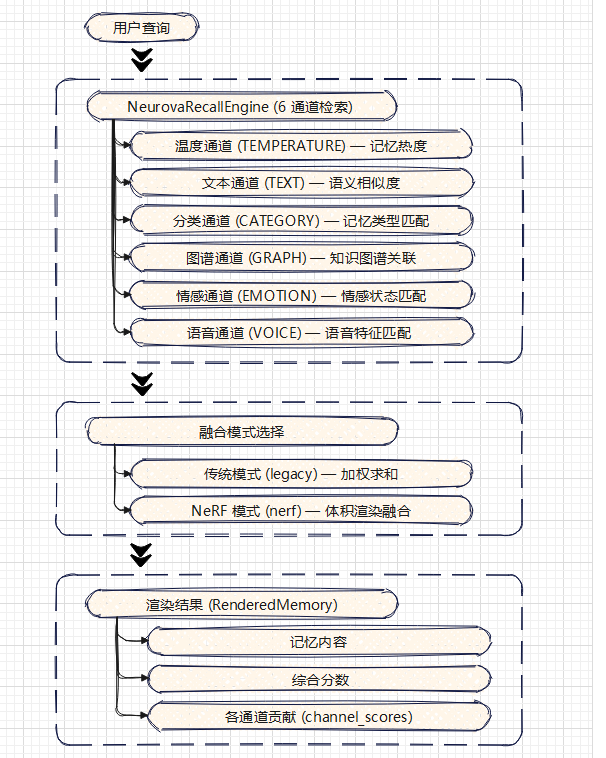
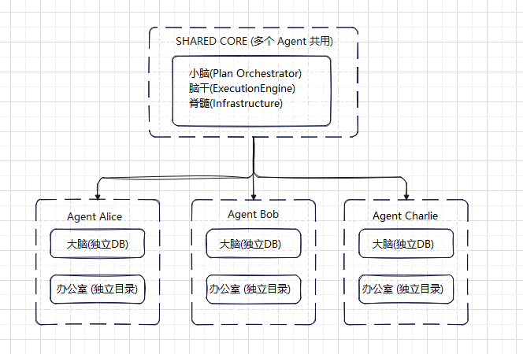

# Neurova

<div align="center">
  
  <h1 style="margin-top: 16px;">Agents with Warmth</h1>
  <p><i>Every agent is a kind star, and you are its keeper.</i></p>
</div>

<br/>

<div align="center">
  <a href="https://github.com/kingsa2020/Neurova/stargazers"></a>
  <a href="https://github.com/kingsa2020/Neurova/issues"></a>
  <a href="https://github.com/kingsa2020/Neurova/blob/main/LICENSE"></a>
  
  
</div>

<br/>

English | [简体中文](README_zh-CN.md)

---

**Neurova** is a self-hosted, MIT-licensed AI agent platform. Create your own agents — with a name, a personality, persistent memory, and constitutional guardrails — and reach them from the Web UI, a CLI REPL, native mobile apps (HarmonyOS / Android), or 14 messaging channels (Telegram, Discord, Feishu/Lark, DingTalk, WeCom, QQ, MQTT, SIP, webhooks…).

- **Backend**: Python 3.10+ / FastAPI / SQLite (FTS5) — no external database required
- **Embeddings**: local ONNX (bge-small-zh-v1.5), auto-degrading to TF-IDF / fastembed / FAISS by environment
- **Frontend**: Vue 3 + TypeScript + Vite + Pinia (11 UI languages)
- **LLMs**: 35+ providers with metadata-driven auto-discovery and per-request-type routing
- **Quality**: 846 backend pytest files, 614 frontend Vitest cases, CI with CodeQL and a coverage gate

> **Why "memory-first"?** Most agent frameworks treat memory as "dump chat history into a vector store". Neurova treats it as a physical system: memories carry temperature, cool down over time, get consolidated while the agent sleeps, and are retrieved through a mixture-of-experts routing with volume-rendering-style fusion. When nothing matches, it says so instead of hallucinating.

## Table of Contents

- [1. Every agent is a unique star](#1-every-agent-is-a-unique-star)
- [2. Memory — 7 types · temperature engine · six-channel retrieval](#2-memory--7-types--temperature-engine--six-channel-retrieval)
- [3. MoE expert routing for memory](#3-moe-expert-routing-for-memory)
- [4. Emotion hub engine — 4 layers, 17 emotions](#4-emotion-hub-engine--4-layers-17-emotions)
- [5. CogArch 2.0 cognitive architecture](#5-cogarch-20-cognitive-architecture)
- [6. Growth — five evolution systems](#6-growth--five-evolution-systems)
- [7. Multi-agent collaboration — swarm · teams · rooms · ACP](#7-multi-agent-collaboration--swarm--teams--rooms--acp)
- [8. Muscle memory for tool calls](#8-muscle-memory-for-tool-calls)
- [9. Tool system — Computer Use + CLI + Skills](#9-tool-system--computer-use--cli--skills)
- [10. Bayesian EKI cognitive optimizer](#10-bayesian-eki-cognitive-optimizer)
- [11. Tool layer — LLM Router + Context Pool + MCP](#11-tool-layer--llm-router--context-pool--mcp)
- [12. Living context pool](#12-living-context-pool)
- [13. RSI — recursive self-improvement with a ratchet](#13-rsi--recursive-self-improvement-with-a-ratchet)
- [14. NeurFlow workflow engine](#14-neurflow-workflow-engine)
- [15. Knowledge bases — isolation & RAG](#15-knowledge-bases--isolation--rag)
- [16. LLM provider management](#16-llm-provider-management)
- [17. MCP governance & security](#17-mcp-governance--security)
- [18. Ontology — a runnable world model](#18-ontology--a-runnable-world-model)
- [Testing](#testing)
- [Security](#security)
- [Multi-platform connections](#multi-platform-connections)
- [Quick start](#quick-start)
- [Project structure](#project-structure)
- [Tech stack](#tech-stack)
- [License](#license)

---

## 1. Every agent is a unique star

Every agent born in Neurova has:

- **Its own name and personality** — not a number, but a character
- **Persistent memory and emotion** — it remembers your conversations, the good and the bad
- **An autonomous growth trajectory** — it learns and evolves through companionship
- **A kind disposition** — behavior rules compiled from its constitution

## 2. Memory — 7 types · temperature engine · six-channel retrieval

### Memory model

| Dimension | Values |
|------|------|
| **Memory types** | semantic, episodic, procedural, pattern, emotional, working, workflow_experience |
| **Categories** | general, conversation, knowledge, experience, tool usage, reflection, user preference |
| **Lifecycle** | active → consolidated → archived → forgotten / crystallized |
| **Origin trust** | owner / agent / untrusted / system — retrieval is down-weighted by origin |
| **Perspective** | first / second / third person, system view (who said it) |

Core implementation: `neurova/cognitive_layers/memory_layer/`, facade: `MemCore` (`neurova/mem_core.py`).

### Write path: admission gate → discipline → dual write

```
conversation / tool results → memory admission gate (secrets blocked)
    → memory discipline (candidate → promoted after ≥3 independent tasks / superseded)
    → MemCore dual write (MemoryManager + session buffer)
    → end-of-turn distillation (LLM induces "facts worth keeping", human-reviewed)
```

- **Admission gate** (`memory_admission.py`): 10 regex groups (private keys, API keys, tokens, JWTs, credential labels) are rejected on hit and audited. `NEUROVA_MEMORY_ADMISSION` = enforce (default) / audit / off.
- **Memory discipline** (`memory_discipline.py`): new writes start as `candidate`; only after being referenced across ≥3 independent tasks are they `promoted`. Contradictory assertions are adjudicated as `superseded` and scheduled for forgetting. Off by default (`NEUROVA_MEMORY_DISCIPLINE`).
- **External memory import** (`memory_ingest/`): import another agent's conversation history as an Ingest Bundle — probe format → plan preview → apply → undo. Up to 200k entries per run.

### Temperature engine (0–100°C)

Every memory carries a temperature:

| Mechanism | Behavior |
|------|------|
| Access heating | proportional: `T += (100−T) × 0.25` per effective hit (deduped per turn; `recall.hit_gain` / `NEUROVA_MEMORY_HIT_GAIN` configurable) |
| No-decay conditions | crystallized, temperature ≥ 95, accessed within 24h |
| Forgetting curve | anchors at 1/7/30/90 days, log-log power-law interpolation |
| User feedback | like +0.5 / dislike −0.5, applied directly to temperature |

Decay rate = curve factor × emotional protection (0.6) × saturation × importance weight × association protection, capped at 0.95.

Temperature drives everything downstream: tiered compression (crystallized kept whole / mid compressed to summaries / cold archived), retrieval scoring, and the sleep job's archival decisions.

### Retrieval stack overview

```
query → UnifiedRetriever
    ├── MoE expert routing (see §3)          ← sparse activation by memory category
    ├── six-channel recall NeurovaRecallEngine ← temperature/text/category/graph/emotion/voice
    │       └── NeRF volume-rendering fusion (legacy/nerf switchable)
    ├── cognitive storage direct lookup
    └── knowledge base retrieval (FTS5 trigram + vector, RRF fusion 0.7/0.3, association cues +0.25)
    → dedup & rank → inject into context pool
```

### NeRF-style volume-rendering fusion

```
Score(m) = Σ T_i · σ_i · c_i · w_i

T_i = transmittance exp(-Σ_{j<i} σ_j)   — accumulated attenuation from earlier channels
σ_i = channel density (text 0.9, emotion 0.8, temperature 0.7, graph 0.6, category 0.5, voice 0.4)
c_i = raw channel score
w_i = query-intent weight
```

Unlike a plain weighted sum, channels attenuate each other through transmittance — the fusion is smoother and more coherent.



| Channel | Role | Density |
|------|------|------|
| Temperature | recency/hotness retrieval | 0.7 |
| Text | semantic similarity | 0.9 |
| Category | memory type matching | 0.5 |
| Graph | knowledge-graph association | 0.6 |
| Emotion | emotional state matching | 0.8 |
| Voice | voice feature matching | 0.4 |

Positional encodings (time / emotion / importance) let the engine "time-travel" to past memory states and distinguish fine emotional gradations. Query intent (FACTUAL / TEMPORAL / CAUSAL / COMPARATIVE / EXPLORATORY) is auto-detected and shifts the channel weights.

**Switching fusion modes**: at runtime via `recall_engine.update_fusion_settings(fusion_mode="nerf")`, or via the API `PUT /api/v1/enhanced-memory-search/nerf-settings`.

### Sleep & compression

- **Sleep consolidation** (`sleep.py`): periodically clusters similar memories and archives low-value ones. LLM-induced consolidation is gated (`NEUROVA_SLEEP_INDUCTION`, default off).
- **Compression** (`compression.py`), five strategies: TIER (by temperature/lifecycle), SEMANTIC clustering, AGGREGATION, LLM summarization, RULE_BASED. Working memory has a per-turn compression endpoint (`/api/v1/memory/wm/compress`).

## 3. MoE expert routing for memory

> Retrieval's bottleneck is often not "not enough compute" but "looking in the wrong place". MoE decides *where to look* with a cheap vector gate, then controls per-query cost with tiered drill-down.

Implementation: `neurova/cognitive_layers/memory_layer/moe_router.py` (`MoEMemoryRouter`), second retriever in the chat pipeline's responsibility chain (UnifiedRetriever → **MoERetriever** → KnowledgeRetriever).

**4 experts, by memory category**: conversation_episodic / factual_knowledge / tool_muscle / experience_lesson.

**Vector gating network**: `activation_i = cosine(query, centroid_i)`, activated if ≥ 0.3, top-3 sparse activation — inactive experts cost nothing.

**Tiered drill-down per expert**:

| Tier | Method | Latency |
|------|------|------|
| L0 | exact SQL index (category/lifecycle/temperature, FIFO cache) | <1ms |
| L1 | structured filters (emotion/temperature) | 1–10ms |
| L2 | TF-IDF keyword re-ranking | 10–50ms |
| L3 | vector similarity fallback | 100–500ms |

**Score fusion & honest fallback**: `score = expert score × activation weight × origin trust weight`. If expert results are insufficient (<3 results or top score <0.4) → full-store vector search; if still nothing → an explicit `NO_MEMORY_HINT` system prompt: *the engine honestly says "no relevant memory" instead of staying silent or making things up.*

**Plasticity**: expert centroids drift with usage (LTP/LTD-style updates); a background progressive index builds semantic embeddings temperature-first (limit default 20k), resumable across restarts.

**MoE vs. NeRF channels**: MoE partitions by *memory category* (4 expert buckets); the six channels are *retrieval dimensions*. They meet in the same responsibility chain with three-way fusion in UnifiedRetriever.

> Note: `neurova/llm/llm_router.py` (LLMRouter) is a rule-based router by capability/priority/health — not an MoE.

## 4. Emotion hub engine — 4 layers, 17 emotions

| Layer | Emotions |
|------|------|
| Basic (5) | joy, sadness, anger, fear, surprise |
| Compound (4) | admiration, jealousy, sympathy, disgust |
| Higher-order (4) | shame, guilt, pride, responsibility |
| Special (4) | love, hate, hope, despair |

- **17 conduction rules** model how emotions influence each other (e.g. joy → hope w=0.7, love → joy w=0.9)
- **Weighted decision-making**: love 1.3 (highest), responsibility 1.2, etc.
- **Memory coupling**: emotional state affects memory temperature — positive emotion stabilizes memories, negative emotion destabilizes them

Design doc: `docs/01-architecture/15-emotion-resonance-engine.md`.

## 5. CogArch 2.0 cognitive architecture

| "Brain region" | Component | Function |
|------|------|------|
| Cortex | cognition hub | observe/understand, recall, reason, decide, self-reflect |
| Cerebellum | planning & coordination | intent decomposition, task generation, orchestration, evaluation, error recovery |
| Brainstem | action output | tool calls, workflow execution, resource scheduling, monitoring |
| Spinal cord | signal pathway | event dispatch, module communication, external channels |

Full loop: `input → observe → recall → reason → decide → orchestrate → execute → reflect → consolidate → evolve`.



> Each agent has its own **brain** (database) and **office** (working directory); all agents share one **cerebellum** (orchestration), **brainstem** (execution) and **spinal cord** (infrastructure).

## 6. Growth — five evolution systems

| System | Function | Effect |
|------|------|------|
| Personality | trait definition & persistence (`GET/PUT /api/v1/personality`) | personality adapts with interaction |
| Motivation | four intrinsic drives (competence, autonomy, growth, meaning) | modulates proactive-question cadence |
| Constitution | behavioral rules compiled into system instructions | the agent stays kind and honest |
| Reflection | five-operator self-model (drift/sequence/contrast/calibration/budget) | periodic "did I do right? can I do better?" |
| Metacognition | self-monitoring, health checks, growth log | awareness of its own state |

Autonomous evolution mechanisms: feedback loops (AdaptiveToolWeights), dreaming (nightly sweep promotes candidate behavior rules, `dreaming.py`), skill-based capability expansion, experience sublimation into lessons/skills, and parameter-level RSI (see §13).

## 7. Multi-agent collaboration — swarm · teams · rooms · ACP

Multi-agent in Neurova is a **governed swarm** (`neurova/agent/swarm.py`) with approval chains, candidate merging, and tenant isolation — plus external coding agents joining the same system over ACP.

### 7.1 Swarm orchestration

The main agent spawns sub-agents via `spawn_subagent`; they run in the background and report back to the parent mailbox:

- **Governance hard limits**: ≤5 concurrent sub-tasks per agent, ≤8000-char task briefs, recursion depth caps, per-model concurrency caps — exceeding returns a structured `rejected` (never silently swallowed)
- **Run state machine**: `pending → running → in_review → completed / failed`, single-point transition guard, every migration lands in an event ledger (replayable)
- **Candidate reports**: member output lands as candidates, merged via CAS after acceptance + review gates; same-base collisions keep both and escalate to a human
- **Full lifecycle**: `subagent_status`, `continue_subagent` (steer or restart), `cancel_subagent`, `escalate`, `submit_result`

### 7.2 Teams & approval chains

| Capability | Description |
|------|------|
| Fixed teams | `/api/v1/teams` rosters with member roles (member/coder/reviewer…) and duty prompts |
| Whole-team dispatch | `dispatch_team` spawns one lane per member with declared step dependencies |
| Approval chains L0/L1/L2 | dangerous actions only escalate (`NEUROVA_SWARM_APPROVAL_MODE`); external agents' tool/command requests map into the chain, fail-closed |
| Team proposals | agents may `propose_team`; human approval required to write the roster |

### 7.3 Collaboration rooms

A room is a collaborative project (`room_id = project_id`); humans and agents share one group chat:

- `@mention` triggers a specific agent; @everyone triggers multi-agent orchestration
- lead-first relay: the lead executes first, supporters build on its output
- approvals, escalations and candidate reports are pushed to the room message stream for in-room adjudication
- anti-storm rate limit: 10 agent messages / 60 seconds, structured rejection beyond
- real-time broadcast over WebSocket/SSE

### 7.4 External coding agents (ACP)

Via **Agent Client Protocol** (JSON-RPC over stdio), external coding agents join team rosters as swarm members (`neurova/agent/neuacp/`):

| External agent | Integration |
|----------|----------|
| OpenCode / Qoder / CodeBuddy / Gemini CLI | ACP native (stdio subprocess) |
| Claude Code / Codex | via ACP adapter (npx) |
| ZCode | plugin form (headless CLI + stream-json, `--resume` supported) |

- **Capability double-gate**: validated at config time and dispatch time; unknown tools take the conservative path (fail-closed)
- **Approval mapping**: `session/request_permission` maps read/search/think → L0, write/execute → L1; verdicts return to the agent
- **Full mirroring**: tool calls, thinking and message chunks mirror into the trace & event ledger (frame replay supported), without managing the agent's internals
- **Process pool**: keyed by `(tenant, tool, command, cwd, transport)`, global cap 4, idle reclaim 600s, crash eviction; SSH-tunnel remote access supported
- **Tenant isolation red line**: rosters, dispatch, process pool, approvals and run ledger are tenant-partitioned end to end; cross-tenant dispatch is rejected
- **Admin surface**: `/api/v1/external-agents` (catalog / test / status / frames, admin-gated); master switch `NEUROVA_EXTERNAL_AGENTS_ENABLED` (default off)

### 7.5 Projects & task boards

- `/api/v1/projects`: an agent-initiated project auto-creates a collaboration room; adding human members or widening visibility requires L1 approval; project dossiers aggregate collaboration traces
- `/api/v1/tasks/boards`: Vue 3 three-column drag-and-drop board (todo / in-progress / done)

> The point of the design: not "can it dispatch tasks" but **dispatch, retrieve, re-brief, and stop** — every step has governance, approvals and a ledger behind it.

## 8. Muscle memory for tool calls

> Like human muscle memory: see the problem → reflex → execute. `neurova/cognitive_layers/memory_layer/muscle_memory.py`.

```
input → muscle-memory match (hybrid confidence, tiered thresholds)
    ├── hit ≥ dynamic threshold → auto-execute (millisecond reflex)
    ├── hit below threshold → presented as suggestion
    └── no hit → retrieval / LLM decision fallback
after any path executes → record_tool_usage()
    ├── success → win streak +1, two consecutive successes promote one tier
    └── failure → streak reset (still recorded, feeding tool weights & reflection)
governance rejections don't count as failures
```

| Tier | Threshold | Speed | Promotion | Decay |
|------|---------|---------|---------|----------|
| L1 muscle | confidence > 0.7 | milliseconds | reached after 3 consecutive successes | 30d unused → L2 |
| L2 hot path | confidence > 0.5 | seconds | 2 consecutive successes | 30d unused → L3 |
| L3 tool memory | confidence > 0.3 | full retrieval | new entries start here | 90d unused → deleted |

`confidence = keyword-fingerprint match (up to +0.6) + semantic cosine (+0.3, local bge ONNX) + historical success rate (+0.1)`; the auto-execution threshold adapts to tool weights. Safety valve: unexecutable parameter shapes are capped at "suggestion", never blind auto-execution.

## 9. Tool system — Computer Use + CLI + Skills

### Computer Use — seeing, not just clicking

| Capability | Implementation |
|------|---------|
| Screenshot | Pillow (real) / simulated |
| Mouse / keyboard | pyautogui (real), DPI & multi-monitor mapping |
| Control-tree snapshot | UI Automation (UIA) `dom-snapshot`, skeleton overview + per-node drill-down |
| Semantic element ops | UIA + snapshot index: `click-element` / `set-value` — no focus stealing, no pixel coordinates |
| SoM annotation | Set-of-Marks numbered region maps + `computer_click_mark` |
| Smart click | semantic target location with pixel fallback (`POST /api/v1/computer/smart-click`) |
| Files & shell | real implementations behind the governance engine |

```bash
python -m neurova.computer_use dom-snapshot --window-title "Notepad" --skeleton
python -m neurova.computer_use click-element --index 3
python -m neurova.computer_use set-value --index 5 --value "Hello, World!"
```

**Safety**: every call passes a four-way governance verdict (allow / deny / ask / sandbox); path whitelists for files, command whitelists + segmented approvals for shell; global keyboard/mouse input requires explicit opt-in (`NEUROVA_ALLOW_GLOBAL_INPUT=1`) with a foreground lease.

### CLI — interactive REPL

`cli.py` is a REPL chat client over the REST/SSE contract: `/agent switch|add|list`, `/llm switch|add`, `/session archive`, `/think 深度|off`, `/memory save|stats`, `/knowledge find|add`, `/search memory|knowledge`, `/health /stats /approval list` and more.

```bash
python start.py --backend              # backend (9527)
python start.py --chat                 # backend + frontend together
python -m neurova.computer_use status  # capability probe
```

### Skill ecosystem

Dynamic registration, event triggers, permission control, governance approvals. Built-ins: memory, web_search, file_operation, kb_builder, github_push. Composite skills chain or parallelize. Every execution emits PRE/POST events; outcomes feed muscle memory; dangerous ops route to human approval and can mint persistent grants. All verdicts are audited (SQLite).

## 10. Bayesian EKI cognitive optimizer

> EKI = Ensemble Kalman Inversion — a gradient-free Bayesian method: a parameter ensemble approximates the posterior, driven by observation residuals. `neurova/cognitive_layers/memory_layer/bayesian_eki/`.

```python
optimizer = get_cognitive_optimizer()   # ensemble 50, lr 0.1
result = optimizer.process_task(task_id="t1", content="draft the weekly report")
# TaskResult: value ∈ trivial..critical | score | confidence | information_gain
#             reinforcement ∈ {REVIEW, CONSOLIDATE, COMPRESS, DISCARD, NONE}
optimizer.register_memory("mem_1", importance=50.0, access_count=3)
retention = optimizer.predict_memory_decay("mem_1", hours_ahead=24.0)
optimizer.batch_update([("mem_1", True, 0.9), ("mem_2", False, 0.2)])
```

The optimizer feeds the temperature engine: review heats up, consolidate crystallizes, compress shrinks, discard drops. Retention prediction pre-strengthens expiring high-value memories.

**Honest boundaries**: `_compute_information_gain` is currently a lexical heuristic (not true KL-divergence information gain); `_flush_updates` explicitly raises `NotImplementedError`; the GP surrogate requires `train_surrogate` first. The code says so.

## 11. Tool layer — LLM Router + Context Pool + MCP

**LLM Router**: 10 request types (CHAT, IMAGE_UNDERSTANDING, AUDIO/VIDEO_UNDERSTANDING, TEXT_TO_IMAGE/VIDEO, IMAGE_TO_VIDEO, TEXT_TO_SPEECH, SPEECH_TO_TEXT, …) matched against 10 model capabilities: capability match → health check → priority ranking → response-time optimization → weighted scoring.

**Context Pool**: 10 context sources (system/developer instruction, memory, conversation, experience, emotion, reflection, tool calls, multimodal, user input) with priority-based token budgets and automatic OpenAI ↔ Anthropic format conversion per target model.

**MCP integration**: connect external tool servers over stdio / SSE / streamable HTTP via `/api/v1/tool-layers`; curated catalog (github / context7 / dbhub) with one-click install; per-user isolation, per-agent tool permissions, human approval for high-risk tools with persistent grants, and a single governance/audit pipeline with no bypass.

**Tool Orchestrator**: unified management of search / compute / file / graph / collaboration (spawn_subagent, dispatch_team, …) / computer-use / browser tool families with chained calls, parallel execution, error recovery and dynamic scheduling.

## 12. Living context pool

> Context is not a stagnant pool but flowing water: fluid, fresh, clean, semantic, on-demand.

| Property | Mechanism |
|------|------|
| Fluidity | time decay + TTL expiry |
| Freshness | creation timestamp + access frequency |
| Purity | exact → pattern → semantic dedup (0.85–0.95 similarity) |
| Semantics | vector matching (bge-small) — understands synonyms and paraphrase |
| On-demand | needs expressed as strings, matched against labeled "drops" |

Drift protection keeps user/assistant pairs intact, preserves timeline order, and applies stricter thresholds to query-relevant content. Token budgets are allocated per source (e.g. system 20% / memory 30% / conversation 40% / experience 10%) and per model window.

API: `POST /api/v1/context/build/v2`, `GET /api/v1/context/stats|composition|budget`, per-context preview/compress, and on-demand injection (`/api/v1/context/inject/reflection|memories|hot`).

## 13. RSI — recursive self-improvement with a ratchet

> Every improvement must be **measured effective** to be kept: apply → measure → keep or rollback. `neurova/evolution/rsi/` (27 modules), orchestrated by `RSIOrchestrator`.

**Ratchet pruner**: three-round funnel (default 50 → 10 → 3). Zero-score candidates are rejected before reaching production; after applying the best candidate, before/after performance is measured for real; a rollback manager reverts harmful changes.

**Optimizable parameters**: 5 families, 15 parameters with hard bounds — sleep (2), emotion (2), experience (3), tool memory (4), context budgets (4); step sizes 5/10/15/20%.

**Triggers**: post-chat cadence (backing off to a 20-turn patrol when converged), experience events (60s throttle), reflection gates (turn + uncompiled-event ≥20 + interval).

**Progressive autonomy**: 0 observe → 1 manual → 2 semi-auto → 3 conditionally-auto → 4 full-auto; promotion requires days-without-rollback, non-negative ROI, convergence whitelist, evidence — never skipped.

**Oversight**: Prometheus metrics (`RSIMetrics`), status at `GET /api/v1/governance/rsi/status`, human approval for improvement proposals and for upgrading the improver itself (I_t → I_{t+1}); audit + debt-ledger reverse gate (unpaid debt blocks promotion).

> The ratchet's meaning is not "always forward" but "never backward".

## 14. NeurFlow workflow engine

| Capability | Status |
|------|------|
| Visual canvas — 6 node types (start/end/task/condition/parallel/subflow) | shipped |
| Debugger — external mock engine, step/step-over, local variable inspection | shipped |
| Version snapshots & rollback — content fingerprint, definition-level versioning | shipped |
| Triggers — Cron + inbound Webhook (HMAC-SHA256 + token bucket) | shipped |
| Subflows — nesting depth ≤5 with cycle detection | shipped |
| Agent compilation — workflow → AgentManifest, chat-side dispatch bridge | shipped |
| Webhook delivery audit | wired |

Debug IDE features: breakpoints on any node, mock value injection, version drawer with diff & rollback, trigger configuration, node-level execution traces.

## 15. Knowledge bases — isolation & RAG

**Four-tier visibility**: public / private (default) / shared_with (users & groups) / approval-gated.

**Pipeline**: hybrid retrieval (vector + FTS5 + RRF) → permission filter (strict 401) → memory sync → context fusion → answer. Adaptive retrieval adjusts strategy by query complexity (default off).

## 16. LLM provider management

- **Metadata-driven**: every provider carries capability / series / priority / scope
- **Auto-discovery**: three-level probe chain (metadata → model list → capability probe)
- **Smart filtering & routing** by capability, series, provider; candidate idempotent merging
- **Async-native streaming**, per-user API-key isolation, 11-language UI

## 17. MCP governance & security

The MCP integration layer is hardened end to end (P0-1…P0-10): authentication on every route (stdio admin-only), shell deny-lists + command whitelists, firewall folded into the `call_tool` main path, full parameter scanning with tiered fail-closed, per-user client isolation (identity injected per request via ContextVar), storage convergence, and dead-path cleanup.

```
request → JWT auth → role gate (admin/user) → firewall pre-check → param scan → audit → execute
            ↓        ↓          ↓                  ↓               ↓
         L0 entry  L1 isolate  L2 output         L3 audit       L4 data
```

## 18. Ontology — a runnable world model

> The ontology is not "another knowledge graph" — it is the agent's **business semantic substrate**: terms, SHACL-style shape constraints, Datalog-style forward-chaining rules, functions, state machines, actions, a decision ledger, and what-if simulation, all on one tenant-partitioned SQLite fact store.

| Component | Capability |
|------|------|
| Term registry | unified naming/definition of concepts, relations, attributes |
| Shape constraints | assertion validation (dry-run before commit) |
| Rule engine | forward chaining with a derivation ledger & precise revocation |
| Functions | read-only evaluation of registered functions |
| State machines | subject state & legal-transition queries |
| Actions | ontology actions executed through ToolExecutor + governance |
| Decision ledger | decisions as first-class objects: record, causal links, trace, precedent search |
| Simulation | clone the world, run zero-production-write what-ifs, output diff reports |
| Abduction | reverse search: "what premises would explain this conclusion" |
| GraphRAG | community-clustering retrieval (global/drift) |

**Bitemporal facts**: every triple carries `valid_from / valid_until / recorded_at / retracted_at` — ask both "what is true now" and "what was true then". The authoritative graph is the fact store (recursive-CTE walks); JSON projection graphs are visualization-only.

**Surfaces**: 22 curated MCP tools at `/v1/mcp` (Service Token / API Key / JWT, fail-closed) and 78 REST endpoints under `/api/v1/knowledge/ontology` + the governance four verbs `/access/{query,analyze,validate,use}`; exports to Turtle / JSON-LD / OWL 2 RL / SHACL / PROV / GraphML / GEXF / Cypher / CSV. Frontend: **Ontology Studio** and **Graph Workbench**.

**Write governance**: every fact write passes a single admission chokepoint (literal-verifiable gate + unknown-predicate candidate approval + async three-state conflict voting).

**Honest boundaries**: enterprise NL2SQL is gated (`NEUROVA_NL2SQL_ENABLED`, default off → 403); connectors (SQL read-only: PostgreSQL/MySQL/MSSQL/Oracle/SQLite; Kingdee/Yonyou ERP REST; files; Unity Catalog/Snowflake/SAP OData; HTTP pull; WeCom/WeChat archives) are per-source disabled by default, admin-gated; SPARQL/rdflib interop is an optional test-only comparison with lazy, fail-soft loading.

## Testing

| Suite | Scale | Status |
|------|------------|------|
| Backend (pytest) | 846 test files (unit 703 / integration 54 / e2e / performance) | core modules covered |
| Frontend (Vitest) | 42 test files, 614 cases green | components & API tests |
| CI | GitHub Actions 6 jobs + 60% coverage gate + vue-tsc + CodeQL | enabled |

```bash
pytest tests/unit/ -v                 # unit tests
python tests/run_all_tests.py         # full pyramid (unit → integration → e2e)
cd NeurUI && npm run test             # frontend
pytest tests/unit/ --cov=neurova --cov-report=html
```

## Security

| Layer | Protection |
|------|---------|
| L0 entry | JWT auth, IP allow/deny lists, rate limits, input security scanning |
| L1 isolation | hard isolation between users (non-negotiable), optional between agents |
| L2 output | API-key masking, sensitive-path interception, file-type protection |
| L3 audit | operation audit logs, security event monitoring, anomaly detection |
| L4 data | encrypted storage, sensitive-data anonymization, right-to-be-forgotten |

All data is isolated by `agent_id` + `neuser_id` + `user_id` (three layers), with opt-in cross-agent sharing.

## Multi-platform connections

Web (NeurUI) · REST API (82 endpoint modules) · Feishu/Lark · DingTalk · WeCom · WeChat · Telegram · Discord · QQ · MQTT · WebSocket · SIP · Webhook · mobile QR-pairing (HarmonyOS & Android native apps)

## Quick start

Requirements: Python ≥ 3.10, Node.js 18+.

```bash
# backend (port 9527)
pip install -r requirements-full.lock
python start.py --backend
# or: python -m uvicorn neurova.api.app:app --reload --host 0.0.0.0 --port 9527

# frontend NeurUI (port 8100, /api and /ws proxy to 9527)
cd NeurUI && npm install && npm run dev

# both at once + health check
python start.py --chat
python start.py --check
```

Copy `.env.example` to `.env` and fill in your LLM API key. Docs (currently Chinese-first): [docs/INDEX.md](docs/INDEX.md).

## Project structure

```
Neurova/
├── neurova/                     # backend core (Python, ~700 files)
│   ├── agent/                   # ChatPipeline, swarm, approval chains
│   │   └── neuacp/              #   ACP external coding agents
│   ├── cognitive_layers/        # memory, emotion, metacognition, MoE routing
│   ├── api/endpoints/           # 82 endpoint modules
│   ├── knowledge/ontology/      # ontology semantic stack
│   ├── neurflow/                # workflow engine
│   ├── computer_use/            # computer use + browser automation
│   ├── evolution/               # RSI ratchet self-improvement
│   ├── context/                 # living context pool
│   ├── channels/                # 14 messaging channels
│   └── ...                      # auth, security, skills, tts/asr, media…
├── NeurUI/                      # frontend (Vue 3 + TS, 60 pages, 11 locales)
├── tests/                       # backend tests (846 files)
├── docs/                        # documentation (single source of truth index)
├── Mobile/                      # harmony / android-native clients
└── start.py / cli.py            # launcher / REPL chat client
```

## Tech stack

**Backend**: Python 3.10+, FastAPI, SQLite (FTS5), FAISS / ONNX (bge-small-zh-v1.5) / fastembed / TF-IDF, Pydantic, uvicorn, pytest.
**Frontend**: Vue 3, TypeScript, Vite, Pinia, Ant Design Vue, ECharts, Vitest.

## License

MIT — see [LICENSE](LICENSE).

## Contributing

Issues and PRs welcome: [Issue Tracker](https://github.com/kingsa2020/Neurova/issues) · [Discussions](https://github.com/kingsa2020/Neurova/discussions). Please read [AGENTS.md](AGENTS.md) for repo conventions before your first PR.

---

> Every agent is a star. Some are warm and remember how you feel; some are sharp and solve hard problems; some are curious and keep learning. You are the keeper — protect them, nurture them, grow with them.
>
> *Neurova — giving every star its warmth.*
