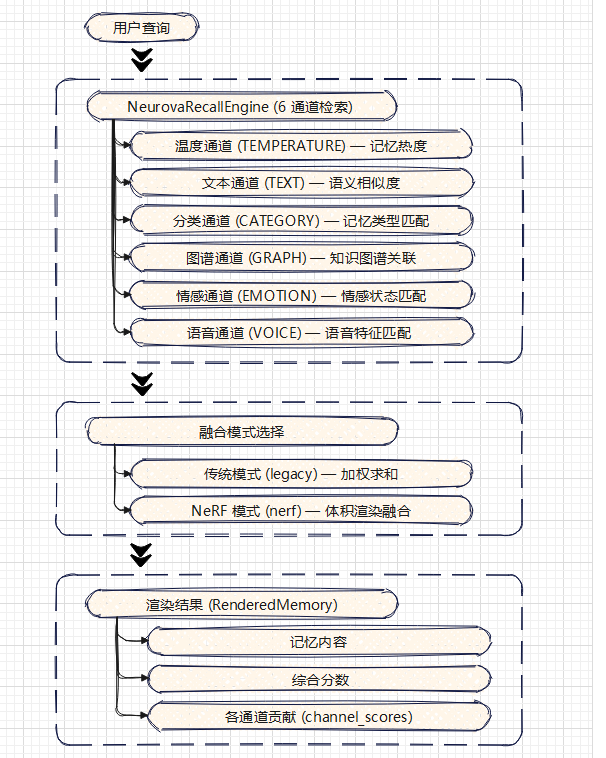
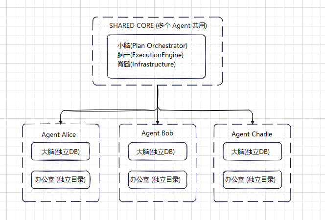

# Neurova

[English](README.md) | 简体中文

<div align="center">
  
  <h1 style="margin-top: 16px;">有温度的智能体</h1>
  <p><i>每一个 Agent 都是一颗善良的星星，而你就是守星人</i></p>
</div>

<br/>

<div align="center">
  <a href="https://github.com/kingsa2020/Neurova/stargazers"></a>
  <a href="https://github.com/kingsa2020/Neurova/issues"></a>
  <a href="https://github.com/kingsa2020/Neurova/blob/main/LICENSE"></a>
  
  
</div>

<br/>

---

## Neurova 独特特点

> **为什么选择 Neurova？** 因为我们重新定义了 AI Agent —— 不是冰冷的工具，而是有温度、能记忆、会成长的智能伙伴。

### 1. 每一颗 Agent 都是独特的星星

每一个 Agent 从诞生起就拥有：
- **独有的名字与人格** — 不是编号，而是有个性的存在
- **持续的记忆与情感** — 记得你们之间的每一次对话，每一次喜怒哀乐
- **自主的成长轨迹** — 在陪伴中学习和进化，变得越来越懂你
- **善良的底色** — 由宪法规则守护的行为准则，永远是你可以信赖的伙伴

---

### 2. 记忆机制 — 七类记忆 · 温度引擎 · NeRF 六通道检索

#### 记忆模型：7 种记忆类型 × 7 种记忆分类

| 维度 | 取值 |
|------|------|
| **记忆类型**（MemoryType） | 语义（semantic）、情景（episodic）、程序（procedural）、模式（pattern）、情感（emotional）、工作记忆（working）、工作流经验（workflow_experience） |
| **记忆分类**（MemoryCategory） | 通用、对话、知识、经验、工具使用、反思、用户偏好 |
| **生命周期**（LifecycleStage） | active → consolidated → archived → forgotten / crystallized |
| **来源信任**（MemoryOrigin） | owner / agent / untrusted / system，检索时按来源降权 |
| **视角标记**（MemoryPerspective） | 第一/第二/第三人称、系统视角 |

核心实现位于 `neurova/cognitive_layers/memory_layer/`（`neurova/memory/` 为兼容层），门面为 `neurova/mem_core.py` 的 `MemCore`。

#### 写入链路：准入闸 → 重纪律 → 双写落库

```
对话/工具结果 → 记忆准入闸（敏感信息拦截）
    → 记忆重纪律（候选 → 3-Task 转正 / 世代失效）
    → MemCore 双写（MemoryManager + 会话缓冲）
    → 轮末蒸馏（LLM 归纳"值得长期记住的事实"，人工审阅落库）
```

- **记忆准入闸**（`memory_admission.py`）：10 组敏感信息正则（私钥、API Key、token、JWT、凭据标签）命中即拒收并审计；策略 `NEUROVA_MEMORY_ADMISSION` = enforce（默认）/ audit / off，支持人工放行令牌。
- **记忆重纪律**（`memory_discipline.py`）：新写入先标 `candidate`，跨 ≥3 个独立任务被引用才转正 `promoted`；矛盾断言经裁决判 `superseded` 并进入遗忘。门控 `NEUROVA_MEMORY_DISCIPLINE` 默认关。
- **外部记忆导入**（`memory_ingest/`）：以 Ingest Bundle 导入外部 agent 的会话记录——probe 识别格式 → plan 预览 → apply 落库 → undo 可回滚，单次上限 20 万条。

#### 温度引擎（0–100°C）

每条记忆带温度：访问升温、时间衰减、反馈调节。

| 参数 | 默认 | 说明 |
|------|------|------|
| 温度域 | 0–100 | 0 = 完全遗忘，100 = 高度活跃 |
| 访问升温 | +10 | 每次命中 `touch()` 升温，封顶 100 |
| 不衰减条件 | — | 已固化（crystallized）、温度 ≥80、24h 内访问过 |
| 遗忘曲线锚点 | 1/7/30/90 天 | 对数-对数幂律插值（模仿人类遗忘曲线） |
| 用户反馈 | like +10 / dislike −15 | 反馈直接作用于温度 |

衰减率 = 曲线因子 × 情感保护(0.6) × 饱和效应 × 重要性权重 × 关联保护，封顶 0.95。

#### 检索栈总览：MoE 路由 → 六通道召回 → 融合

```
查询 → 统一检索器 UnifiedRetriever
    ├── MoE 专家路由（见第 3 节）          ← 按记忆类别稀疏激活
    ├── 六通道召回 NeurovaRecallEngine      ← 温度/文本/分类/图谱/情感/语音
    │       └── NeRF 体渲染融合（legacy/nerf 可切）
    ├── 认知存储直查（CognitiveStorageEngine）
    └── 知识库检索（FTS5 trigram + 向量 RRF 融合，权重 0.7/0.3，联想线索 +0.25）
    → 去重排序 → 注入上下文池
```

向量后端四档自适应：TF-IDF → ONNX（bge-small-zh-v1.5，默认推荐）→ fastembed → FAISS，按环境自动降级。

#### 睡眠整理与压缩

- **睡眠整理**（`sleep.py`）：语义聚类合并相似记忆、衰减归档低价值记忆；LLM 归纳式整理由 `NEUROVA_SLEEP_INDUCTION` 门控（默认关）。
- **记忆压缩**（`compression.py`）五种策略：TIER（按温度/生命周期分层：固化全保留、中温压缩为摘要、低温归档）、SEMANTIC（语义聚类合并）、AGGREGATION（同主题聚合）、LLM（合并摘要）、RULE_BASED（规则确定性压缩）；工作记忆另有轮级压缩端点（`/api/v1/memory/wm/compress`）。
- **贝叶斯 EKI 优化器**（第 10 节）：以集合卡尔曼反演（简化版）评估任务信息增益、预测记忆衰减、推荐强化。

---

#### NeRF 增强检索：六通道体积渲染融合

> **核心创新**：将 NeRF（Neural Radiance Fields）的体渲染理论迁移到记忆检索，实现从离散搜索到连续语义场渲染的范式转变。

#### 系统架构



#### NeRF 体积渲染公式

**核心公式**：
```
Score(m) = Σ T_i · σ_i · c_i · w_i

其中：
- T_i = exp(-Σ_{j<i} σ_j)  — 透射率（前面通道的累积衰减）
- σ_i = channel_density[i]  — 通道密度（默认：text=0.9, emotion=0.8, temperature=0.7, graph=0.6, category=0.5, voice=0.4）
- c_i = channel_score[i]    — 通道原始分数
- w_i = intent_weight[i]    — 查询意图权重
```

**与传统加权求和的区别**：
| 特性 | 传统加权求和 | NeRF 体积渲染 |
|------|-------------|---------------|
| 融合方式 | `Σ w_i · c_i` | `Σ T_i · σ_i · c_i · w_i` |
| 通道关系 | 独立加权 | 透射率衰减（前面通道影响后面） |
| 密度控制 | 无 | 每个通道有独立密度参数 |
| 物理意义 | 简单平均 | 模拟光线穿过介质的衰减 |

#### 六通道检索架构

| 通道 | 功能 | 默认密度 | 典型场景 |
|------|------|----------|----------|
| **温度通道** | 记忆热度检索 | 0.7 | 检索最近/最热的记忆 |
| **文本通道** | 语义相似度 | 0.9 | 基于内容的检索 |
| **分类通道** | 记忆类型匹配 | 0.5 | 按记忆类型过滤 |
| **图谱通道** | 知识图谱关联 | 0.6 | 检索关联记忆 |
| **情感通道** | 情感状态匹配 | 0.8 | 检索情感相关的记忆 |
| **语音通道** | 语音特征匹配 | 0.4 | 语音记忆检索 |

#### 位置编码（Positional Encoding）

**时间位置编码**：
```python
γ(t) = (sin(2⁰πt), cos(2⁰πt), sin(2¹πt), cos(2¹πt), ..., sin(2^(L-1)πt), cos(2^(L-1)πt))
```
- 捕捉时间衰减的高频细节
- 支持"时间旅行"：查询过去某个时间点的记忆状态

**情感位置编码**：
```python
γ(e) = (sin(2⁰πe), cos(2⁰πe), ..., sin(2^(L-1)πe), cos(2^(L-1)πe))
```
- 捕捉情感强度的细微变化
- 区分"有点开心"和"非常开心"

**重要性位置编码**：
```python
γ(i) = (sin(2⁰πi), cos(2⁰πi), ..., sin(2^(L-1)πi), cos(2^(L-1)πi))
```
- 捕捉重要性的连续变化
- 支持渐进式检索（从模糊到精确）

#### 查询意图自适应（QueryIntent）

| 意图类型 | 说明 | 通道权重调整 |
|----------|------|-------------|
| **FACTUAL** | 事实型查询 | 文本通道权重最高 |
| **TEMPORAL** | 时间型查询 | 温度通道权重最高 |
| **CAUSAL** | 因果型查询 | 图谱通道权重最高 |
| **COMPARATIVE** | 对比型查询 | 分类通道权重最高 |
| **EXPLORATORY** | 探索型查询 | 所有通道均匀权重 |

**意图检测**：
```python
# 自动检测查询意图
intent = query_intent_detector.detect("昨天的项目会议讨论了什么？")
# 返回: QueryIntent.TEMPORAL

# 根据意图调整通道权重
weights = intent_aware_strategy.get_weights(intent)
# 返回: {"temperature": 0.4, "text": 0.3, "category": 0.1, "graph": 0.1, "emotion": 0.05, "voice": 0.05}
```

#### 融合模式切换

**传统模式 (legacy)**：
```python
score = Σ (weight[i] * channel_score[i])
```
- 简单加权求和
- 向后兼容
- 性能最优

**NeRF 模式 (nerf)**：
```python
score = Σ (transmittance[i] * density[i] * channel_score[i] * weight[i])
```
- 体积渲染融合
- 通道间有透射率衰减
- 结果更平滑、更连贯

**切换方式**：
```python
# 运行时切换
recall_engine.update_fusion_settings(fusion_mode="nerf", density_scale=1.5)

# API 切换
PUT /api/v1/enhanced-memory-search/nerf-settings
{
  "fusion_mode": "nerf",
  "density_scale": 1.5,
  "channel_densities": {"text": 0.95, "emotion": 0.85}
}
```

#### 通道密度配置

**默认密度**：
```python
DEFAULT_CHANNEL_DENSITIES = {
    "text": 0.9,        # 文本通道密度最高
    "emotion": 0.8,     # 情感通道次之
    "temperature": 0.7, # 温度通道中等
    "graph": 0.6,       # 图谱通道较低
    "category": 0.5,    # 分类通道较低
    "voice": 0.4        # 语音通道最低
}
```

**密度缩放**：
```python
# 全局密度缩放因子
density_scale = 1.5  # 默认 1.0

# 实际密度 = 默认密度 × 缩放因子
actual_density = default_density * density_scale
```

#### 完整数据流

```
用户查询 → 查询意图检测 (QueryIntentDetector)
    ↓
六通道并行检索
    ├── 温度通道 → 按温度排序
    ├── 文本通道 → 向量相似度
    ├── 分类通道 → 类型匹配
    ├── 图谱通道 → 图谱遍历
    ├── 情感通道 → 情感匹配
    └── 语音通道 → 语音特征
    ↓
融合模式选择
    ├── legacy → 加权求和
    └── nerf → 体积渲染
    ↓
渲染结果 (RenderedMemory)
    ├── memory_id
    ├── content
    ├── score (综合分数)
    ├── channel_scores (各通道贡献)
    └── nerf_rendered (是否 NeRF 渲染)
    ↓
API 响应 → 前端展示
    ├── NeRF 标签
    └── 通道可视化条
```

#### 核心文件结构

```
neurova/cognitive_layers/memory_layer/
├── manager.py                 # MemoryManager 门面（CRUD + FTS5/RRF 混合召回）
├── neurova_recall.py          # 六通道检索引擎（含 NeRF 融合）
├── moe_router.py              # MoE 专家混合记忆路由（见第 3 节）
├── muscle_memory.py           # 工具肌肉记忆 L1/L2/L3（见第 8 节）
├── unified_retriever.py       # 统一检索器（CSE 直查 + MoE + 六通道三路融合）
├── unified_vector_store.py    # 四档自适应向量库（TF-IDF/ONNX/fastembed/FAISS）
├── volume_renderer.py         # NeRF 体积渲染器
├── positional_encoding.py     # 位置编码
├── temperature.py             # 温度引擎（0–100°C 贝叶斯遗忘曲线）
├── compression.py             # 记忆压缩（五种策略）
├── sleep.py                   # 睡眠整理（聚类合并/衰减归档）
└── bayesian_eki/              # 贝叶斯 EKI 认知优化器（见第 10 节）

neurova/api/endpoints/
└── enhanced_memory_search_api.py  # NeRF 设置 API

NeurUI/src/pages/
├── MemoryPage.vue             # 记忆列表（NeRF 标签）
└── MemorySearchSettingsPage.vue  # NeRF 设置页面
```

> **设计理念**：将 NeRF 的"连续场渲染"思想引入记忆检索，从离散的"搜索-排序"范式转变为连续的"语义场渲染"范式。通过六通道并行检索、位置编码、查询意图自适应、体积渲染融合，实现更自然、更平滑、更智能的记忆检索体验。

---

### 3. 独创检索 — MoE 专家混合记忆路由

> **核心理念**：把"检索哪些记忆"变成一个可学习的路由问题——4 个按记忆类别特化的专家、向量门控稀疏激活、专家内四级递进下钻。热记忆毫秒级命中，冷记忆向量兜底，绝不静默返回空。

实现位于 `neurova/cognitive_layers/memory_layer/moe_router.py`（`MoEMemoryRouter`），由 `MemCore.init_moe_router` 装配，是聊天管线记忆检索责任链的第二级检索器（UnifiedRetriever → **MoERetriever** → KnowledgeRetriever）。

#### 专家划分（4 个，按记忆类别）

| 专家 | 覆盖的记忆 | centroid 初始化 |
|------|-----------|----------------|
| **conversation_episodic** | 对话情景记忆 | 专家描述文本编码 |
| **factual_knowledge** | 事实知识 | 同上 |
| **tool_muscle** | 工具肌肉记忆 | 同上 |
| **experience_lesson** | 经验教训 | 同上 |

#### 向量门控网络（VectorGatingNetwork）

```
activation_i = cosine(query_vec, centroid_i)
activated = { i | activation_i ≥ threshold(默认 0.3)，取 Top-3 稀疏激活 }
```

只有被激活的专家参与本轮检索——无关专家零开销。

#### 专家内 L0→L3 递进下钻（ExpertDrilldownRetriever）

| 层级 | 手段 | 延迟 |
|------|------|------|
| **L0** | SQL 精确索引（按类别/生命周期/温度排序，带 FIFO 缓存） | <1ms |
| **L1** | 结构化过滤（情感/温度） | 1–10ms |
| **L2** | TF-IDF 关键词重排 | 10–50ms |
| **L3** | 向量相似度兜底（UnifiedVectorStore） | 100–500ms |

#### 得分融合与诚实兜底

```
score = 专家原始分 × 激活权重 activation × 来源信任权重(origin)
```

- 按作用域 fail-closed 过滤后排序取 top；
- 专家结果不足（<3 条或最高分 <0.4）→ 全库向量搜索兜底；
- 仍无结果 → 返回 `NO_MEMORY_HINT` 系统提示（score=1.0），**诚实告知"没有相关记忆"，而不是沉默或编造**。

#### 质心可塑性与后台索引

- **质心漂移**：专家质心支持 LTP/LTD 式更新（`update_centroid` / `touch_centroid`），随使用分布缓慢演化；
- **后台渐进索引**：全库按温度优先渐进建立语义索引（上限 `vector_search.moe_index_limit`，默认 2 万条），状态落盘支持重启跳扫；
- **运行期同步**：写入/删除实时镜像进 MoE 向量库。

#### 与 NeRF 六通道的关系：两套机制，一条链

| | MoE 专家路由 | NeRF 六通道 |
|---|---|---|
| 划分对象 | **记忆类别**（4 个专家桶） | **检索维度**（温度/文本/分类/图谱/情感/语音） |
| 融合方式 | 激活权重 × 来源信任 | 通道密度 × 透射率（体渲染） |
| 交汇点 | 同一条检索责任链 + UnifiedRetriever 三路融合 | 同左 |

> **注意**：`neurova/llm/llm_router.py` 的 LLMRouter 是按能力/优先级/健康度的**规则路由器**（请求类型 → 模型能力 → 选模型），不是 MoE。

> **设计理念**：检索的瓶颈往往不是"算得不够多"，而是"查错了地方"。MoE 用极 cheap 的向量门控决定"去哪个专家找"，再用分层下钻控制每次查询的成本曲线——快慢结合，且对"查不到"保持诚实。

---

### 4. 情感中枢引擎 v3.0 — 四层17种情感体系

Neurova v3.0 引入了**情感中枢引擎**，基于心理学的情感分类理论，建立了四层17种情感的完整体系。

#### 四层情感分类：

**第一层：基本情感（5种）**
- 喜悦 (Joy)、悲伤 (Sadness)、愤怒 (Anger)、恐惧 (Fear)、惊讶 (Surprise)

**第二层：复合情感（4种）**
- 爱慕 (Admiration)、嫉妒 (Jealousy)、同情 (Sympathy)、厌恶 (Disgust)

**第三层：高级情感（4种）**
- 羞耻感 (Shame)、内疚感 (Guilt)、自豪感 (Pride)、责任感 (Responsibility)

**第四层：特殊情感（4种）**
- 爱 (Love)、恨 (Hate)、希望 (Hope)、绝望 (Despair)

#### 核心特性：

-  **情感传导规则**（17条规则定义情感间的相互影响）
  - 例如：喜悦 → 希望（权重0.7）、爱 → 喜悦（权重0.9）
-  **情感加权决策**（不同情感对决策的影响权重不同）
  - 爱 (Love): 权重1.3（最高）、责任感 (Responsibility): 权重1.2
-  **与记忆系统集成**（情感状态影响记忆温度）
  - 积极情感 → 降低温度（记忆更稳定）
  - 消极情感 → 提高温度（记忆更不稳定）

 **详细设计文档**：`docs/01-architecture/15-emotion-resonance-engine.md`

---

### 5. CogArch 2.0 认知架构 — 类脑的思考方式

Neurova 采用 **CogArch 2.0 认知架构**，模拟人类大脑的信息处理方式。

#### 四大认知中枢（仿人脑分区）：

| 脑区 | 对应概念 | 功能 |
|------|---------|------|
| **大脑皮层** | 认知中枢 | 观察理解、记忆召回、逻辑推理、行为决策、自我反思 |
| **小脑** | 计划协调 | 意图拆解、任务生成、执行编排、结果评估、错误恢复 |
| **脑干** | 行动输出 | 工具调用、工作流执行、资源调度、执行监控 |
| **脊髓** | 信息通路 | 事件分发、模块通信、外部渠道接入 |

**完整认知循环**：

```
输入 → 观察 → 回忆 → 推理 → 决策 → 编排 → 执行 → 反思 → 巩固 → 学习进化
```

**共享核心架构**：



> **设计理念**：每个 Agent 都有自己的**大脑**（数据库）和**办公室**（工作目录），但所有 Agent 共用一套**小脑**（计划编排）、**脑干**（执行引擎）和**脊髓**（基础设施）！

---

### 6. 持续进化能力 — 会成长的智能伙伴

Neurova 的 Agent **会成长**。每一次对话、每一次任务、每一次反思，都是它进化的养料。

#### 五大进化系统：

| 系统 | 功能 | 效果 |
|------|------|------|
|  **人格系统** | 人格特质定义与持久化（GET/PUT `/api/v1/personality`） | Agent 性格随互动调整；自动进化端点预留未开放 |
|  **动机系统** | 自我决定论四内驱力：胜任、自主、成长、意义 | 经动机台账调制主动提问节奏——会主动学习、主动关心 |
|  **宪法系统** | 行为准则和伦理约束，编译进系统指令 | 确保 Agent 始终保持善良和正直 |
|  **反思系统** | 五算子自模型（漂移/序列/对比/校准/预算） | 定期反思"我做的对吗？""我能更好吗？" |
|  **元认知** | 自我监控、健康检查、成长日志 | Agent 意识到自己的状态，自我调节 |

**自主进化机制**：
1. **反馈闭环** — 形成"行动→反馈→工具权重调整→再行动"闭环（AdaptiveToolWeights）
2. **梦境整理** — 夜间 sweep 把候选行为规则升格为生效规则（dreaming.py）；睡眠记忆整合见第 2 节
3. **能力自主扩展** — 通过 Skill 系统动态加载新能力
4. **记忆升华** — 经验记忆升华为"教训记忆"或"技能记忆"
5. **递归自我改进（RSI）** — 见第 13 节：以实测增益与回滚门约束的参数级自进化

---

### 7. 多智能体协作 — 蜂群编排 · 团队 · 群聊房间 · IDE 外部代理接入

Neurova 的多 Agent 协作不是简单的"任务分发"，而是一套带治理、审批、候选合并与租户隔离的**蜂群编排系统**（Swarm，`neurova/agent/swarm.py`），并支持把 IDE 里的外部编码代理（ACP 协议）编入同一套协作体系。

#### 7.1 蜂群编排（Swarm）

主 Agent 通过 `spawn_subagent` 动态派生子 Agent，后台执行、终态回灌父会话邮箱：

- **治理硬限**：单 Agent 并发子任务 ≤5、任务书 ≤8000 字符、递归深度上限、每模型并发帽与派生错峰——超限返回结构化拒绝（`rejected` + 拒绝码），不静默吞掉；
- **Run 状态机**：`pending → running → in_review → completed / failed`，迁移收口单点（非法迁移直接抛错），每次迁移落事件账本，可回放、可追溯；
- **结果候选制**：成员产出先落**候选报告**，经验收门 + 评审门双门后按 CAS（乐观并发）合入；同基准撞车双保留并升级人工裁决；
- **全生命周期管理**：`subagent_status`（查岗/集成报告/事件流）、`continue_subagent`（运行中 steer 插话或 restart 重派）、`cancel_subagent`（叫停并落账）、`escalate`（升级）、`submit_result`（提交）。

#### 7.2 团队与审批链

| 能力 | 说明 |
|------|------|
| **固定团队** | `/api/v1/teams` 创建团队名册，成员带角色（member/coder/reviewer…）与职责 prompt |
| **整队派活** | `dispatch_team` 按名册每成员一路 spawn，支持按名册声明步间依赖 |
| **审批链 L0/L1/L2** | 危险动作只升不降（`NEUROVA_SWARM_APPROVAL_MODE`）；外部代理的每次工具/命令请求映射到审批链，fail-closed |
| **团队沉淀** | Agent 可 `propose_team` 提议新团队，需人批准后写入名册 |

#### 7.3 群聊房间（协作房间）

房间即协作项目（`room_id = project_id`），人与 Agent 同群协作：

- **@点名应答**：`@成员` 触发指定 Agent 应答，未@时回落默认应答者；@全体成员判定为协作指令，触发多 Agent 协作编排；
- **主从接力**：主执行者（lead）先行，支援成员依赖 lead 的产出接力执行；统一任务书含分工、近史摘要与产出要求；
- **审批上墙**：swarm 审批单、升级、候选报告实时推送到房间消息流，群主/管理员可在房间里直接裁决、拦截或采纳；
- **防信息风暴**：Agent 发言滑动窗口限频（10 条/60 秒），超限结构化拒绝并审计；
- **实时推送**：房间事件经 WebSocket/SSE 广播（复用会话同步通道）。

#### 7.4 IDE / 外部编码代理接入（ACP）

通过 **Agent Client Protocol（ACP，JSON-RPC over stdio）** 把外部编码代理编入团队名册，作为 swarm 成员被派活——为团队补上"编码执行域"（`neurova/agent/neuacp/`）：

| 外部代理 | 接入方式 |
|----------|----------|
| **OpenCode / Qoder / CodeBuddy / Gemini CLI** | ACP 原生（stdio 子进程） |
| **Claude Code / Codex** | 经 ACP 适配器（npx）接入 |
| **ZCode** | 插件形态（headless CLI + stream-json，支持 `--resume` 续跑） |

- **能力双闸**：配置期与派活期各校验一次能力声明（传输方式/审批模式/流式/会话复用），未知工具保守档 fail-closed；
- **审批映射**：外部代理的 `session/request_permission` 同步映射到本仓审批链（读/搜/想 → L0，写/执行 → L1），裁决结果回传代理；
- **全量镜像**：代理的工具调用、思考、消息 chunk 全量镜像进轨迹与事件账本（帧账本可回放），但不纳管其内部执行；
- **进程池复用**：按 `(租户, 工具, 命令, cwd, transport)` 复用子进程，全局上限默认 4、空闲 600 秒回收、崩溃踢出；亦支持 SSH 隧道远程接入；
- **租户隔离红线**：名册、派活、进程池、审批、运行台账全链按 JWT 租户隔离，跨租户派活直接拒绝；
- **管理面**：`/api/v1/external-agents`（catalog / test 握手连通 / status 进程池 / frames 帧回放，admin 门）；总开关 `NEUROVA_EXTERNAL_AGENTS_ENABLED`（默认关）；
- **前端**：团队成员表单内直接配置外部代理（工具目录 + 本机安装探测 + 测试连接），帧账本页可回放代理执行过程。

#### 7.5 项目与任务看板

- **项目治理**：`/api/v1/projects`——Agent 发起项目即自动建协作房间；新增人类成员、放宽可见性走 L1 审批；项目档案（dossier）聚合协作轨迹；
- **任务看板**：`/api/v1/tasks/boards`——Vue 3 三列拖拽看板（todo / in-progress / done），与项目、团队联动。

> **设计理念**：多 Agent 协作的关键不是"能派任务"，而是**派得出去、收得回来、改得了需求、叫得停**——每个环节都有治理、审批与账本兜底。外部编码代理的接入让"会话型 Agent"与"IDE 里的编码 Agent"在同一个协作体系里分工。

---

### 8. 肌肉记忆（Muscle Memory）— 工具调用的闭环学习（Neurova 核心特性）

> **核心理念**：像人类肌肉记忆一样 — 看到问题 → 条件反射 → 直接执行（无需思考）。实现位于 `neurova/cognitive_layers/memory_layer/muscle_memory.py`，已替代早期基于检索的 ToolMemory。

#### 完整闭环：

```
用户输入 → 肌肉记忆匹配（混合置信度，分层阈值）
    ├── 命中且 ≥ 动态阈值 → 自动执行（毫秒级条件反射）
    ├── 命中但置信度不足 → 作为建议呈现（suggest）
    └── 未命中 → 传统检索 / LLM 决策兜底
任意路径执行后 → record_tool_usage()
    ├── 成功 → 连胜 +1，连续成功 2 次晋升一层（L3→L2→L1）
    └── 失败 → 连胜清零（同样入账，供工具权重与反思使用）
治理拒绝不计失败，避免污染记忆
```

#### 三层记忆架构：

| 层级 | 命中阈值 | 响应速度 | 晋升条件 | 遗忘条件 |
|------|---------|---------|---------|----------|
| **L1 肌肉记忆** | 置信度 > 0.7 | 毫秒级（条件反射） | 连续 3 次成功抵达 | 30 天未用 → L2 |
| **L2 热路径** | 置信度 > 0.5 | 秒级（快速检索） | 连续 2 次成功晋升 | 30 天未用 → L3 |
| **L3 工具记忆** | 置信度 > 0.3 | 需完整检索 | 新记忆由此起步 | 90 天未用 → 删除 |

**置信度打分**（三层同一公式，仅阈值不同）：

```
confidence = 关键词指纹匹配（全等 +0.6 / 部分匹配按 F1）
           + 语义余弦相似度（+0.3，本地 bge ONNX 嵌入，NEUROVA_MUSCLE_SEMANTIC 可关）
           + 历史成功率（+0.1）
```

**关键特性**：
- **条件反射**：L1 级别毫秒级响应，像人类肌肉记忆一样
- **自动固化**：新记忆从 L3 起步，连续成功逐级晋升至 L1
- **智能遗忘**：30 天未用逐级降级、90 天未用删除，保持记忆系统高效
- **动态置信度阈值**：按工具权重自适应（见第 11 节），高权重工具更易自动执行
- **安全阀**：命中参数形状不可执行时封顶为"建议"，不盲目自动执行
- **Skill 联动**：Skill 执行成功/失败都记入肌肉记忆，成功经验逐级固化

---

### 9. 强大的工具系统 — Computer Use + CLI + Skill 生态

Neurova 提供**三位一体**的工具能力：**Computer Use（视觉理解）** + **CLI 命令库** + **Skill 生态**，让 Agent 真正拥有"手"和"工具箱"。

#### Computer Use — 视觉理解增强版

> 不只是"盲操作"，而是"看得见"的智能交互

Neurova 的 Computer Use 能力支持**真实模式**和**模拟模式**，并引入了**视觉理解**能力：

| 能力 | 实现方式 | 说明 |
|------|---------|------|
| **桌面截图** | Pillow (真实) / 模拟 | 全屏或区域截图，返回 base64 图像 |
| **鼠标操作** | pyautogui (真实) / 模拟 | 点击、拖拽、滚动（DPI/多屏换算） |
| **键盘输入** | pyautogui (真实) / 模拟 | 文本输入、快捷键 |
| **文件操作** | 真实实现 | 读写文件，受治理引擎保护 |
| **Shell 命令** | subprocess | 执行系统命令，受治理引擎保护 |
| **控件树快照** | UIAutomation（UIA） | dom-snapshot 拿到控件树，支持骨架概览与按节点下钻 |
| **语义元素操作** | UIA + 快照索引 | `click-element` / `set-value` 按快照元素定位，不抢焦点、不依赖像素坐标 |
| **SoM 视觉标注** | Set-of-Marks 编号区域图 | 截图打标编号区域 + `computer_click_mark`（scipy 启发式检测器，可注入替换） |
| **智能点击** | 语义定位 + 坐标兜底 | REST `POST /api/v1/computer/smart-click` 或工具 `computer_click_element`，按语义目标定位元素 |

**语义操作工作流程**：
```
dom-snapshot 控件树 → 按名称/类型/索引定位元素 → 
click-element / set-value 语义操作 → 失败回落像素级 pyautogui
```

**智能点击示例**：
```bash
# 拿到控件树快照（含元素 index/runtime_id）
python -m neurova.computer_use dom-snapshot --window-title "记事本" --skeleton

# 按快照元素语义点击/写值（不抢焦点）
python -m neurova.computer_use click-element --index 3
python -m neurova.computer_use set-value --index 5 --value "Hello, World!"
```

**安全机制**（治理四级裁决）：
- 每次工具调用经治理引擎裁决：allow / deny / ask（转人工审批）/ sandbox
- 文件操作受路径白名单保护、Shell 命令白名单 + 分段审批、输出内容脱敏
- 全局键鼠输入需显式开启（`NEUROVA_ALLOW_GLOBAL_INPUT=1`），并有前台租约互斥

---

#### CLI 命令库 — 交互式 REPL + 专用模块入口

`cli.py` 是**交互式 REPL 聊天客户端**（基于后端 REST/SSE 契约），命令以 `/` 前缀交互：

```
/agent switch|add|del|list       # Agent 切换与管理
/llm switch|add|del|list         # LLM 提供商切换与管理
/session del|archive  /new  /history   # 会话管理
/think 简单|标准|深度|off         # 思考档位
/file clear  /approval list  /reject   # 附件与审批
/memory save|stats|del  /memories del  # 记忆管理
/knowledge list|find|add|del  /search memory|knowledge  # 知识与搜索
/health /stats /logs /monitor /status  # 诊断与监控
/login /help /clear /stop /stream /exit
```

服务编排与 Computer Use 走专用入口：

```bash
python start.py --backend              # 启动后端（9527）
python start.py --chat                 # 前后端一起启动
python -m neurova.computer_use status  # Computer Use 能力探测（真入口）
```

> 其余管理操作（MCP Server 连接、工具市场、技能池、外部代理目录、进化治理等）统一走 REST API（见下方 API 端点表），不设 `neurova <子命令>` 形态。

---

#### Skill 生态 — 完善的技能系统

Neurova 的 Skill 系统支持**动态注册**、**事件触发**、**权限控制**、**治理审批**

**核心架构**：

```
Skill 系统
├── 内置 Skill
│   ├── 记忆管理 (memory) — 添加、查询、删除记忆
│   ├── 网络搜索 (web_search) — 搜索网络信息
│   ├── 文件操作 (file_operation) — 读写文件（受路径保护）
│   ├── 知识库构建 (kb_builder) — 知识库导入与构建
│   └── GitHub 推送 (github_push) — Git 操作封装，支持直接推送到 main 分支
│
├── 外部 Skill
│   └── 自定义 Skill（技能市场 / 技能池分发）
│
└── 复合 Skill
    ├── 链式 Skill (多 Skill 串联)
    └── 并行 Skill (多 Skill 并行)
```

**GitHub Push Skill 示例**：

```python
from neurova.skills.builtin.github_push import create_github_push_skill

# 创建技能实例
skill = create_github_push_skill()

# 完整推送工作流
result = await skill.execute({
    "action": "full_push",
    "message": "添加新功能",
    "push_to_main": True  # 直接推送到 main 分支
})

# 支持的操作：
# - status: 获取 Git 状态
# - add: 添加文件到暂存区
# - commit: 提交更改
# - push: 推送到远程仓库
# - full_push: 完整工作流（状态→添加→提交→推送）
```

**Skill 基类**（所有 Skill 必须继承）：
```python
class Skill:
    def __init__(self, name: str, description: str, tags: List[str] = None):
        self.name = name
        self.description = description
        self.status = SkillStatus.ACTIVE
    
    def execute(self, **kwargs) -> SkillResult:
        """执行 Skill，子类必须实现"""
        raise NotImplementedError
    
    def get_info(self) -> SkillInfo:
        """获取 Skill 信息"""
        return SkillInfo(...)
```

**SkillRegistry（注册中心）**：
- 注册/注销 Skill
- 别名支持（为长名技能配置简称）
- 执行前后事件触发（`PRE_EXECUTE`, `POST_EXECUTE`）
- 使用统计（execution_count, last_used）
- 权限控制（按 Agent 隔离）

**事件系统**（与肌肉记忆联动）：
```python
# 执行前事件
registry._emit_event(SkillEvent.PRE_EXECUTE, skill=skill, kwargs=kwargs)

# 执行后事件 → 肌肉记忆记录执行经验（成功/失败都入账）
registry._emit_event(SkillEvent.POST_EXECUTE, skill=skill, result=result)
```

**Skill 执行流程**：
```
注册 Skill → 触发 PRE_EXECUTE 事件 → 执行 Skill → 
更新统计 (usage_count, last_used) → 触发 POST_EXECUTE 事件 → 
肌肉记忆记录成功/失败经验 → 下次相似问题命中即条件反射复用
```

**协议兼容**：
- 统一的 Skill 接口抽象

**治理与审批**：
- 每次执行经治理引擎四级裁决（allow / deny / ask / sandbox）
- 高危操作转人工审批（ASK），审批通过可铸造持久授权
- 每次裁决落审计账（SQLite），可回溯

---

**三位一体工具能力总结**：

| 能力 | 实现状态 | 关键特性 |
|------|---------|---------|
| **Computer Use** |  真实+模拟 | UIA 控件树语义操作、SoM 视觉标注、像素级兜底、治理四级裁决 |
| **CLI 命令库** |  交互式 REPL | `/agent` `/llm` `/memory` 等会话命令 + `python -m neurova.computer_use` 模块入口 |
| **Skill 生态** |  内置 5 技能 + 市场/技能池 | 动态注册、事件触发、治理审批、肌肉记忆联动 |

> **设计理念**：工具不是附加功能，而是 Agent 的"手"和"工具箱"。Computer Use 让 Agent 能操作电脑，CLI 让管理员能高效管理，Skill 让 Agent 能动态扩展能力——三者共同构建了一个**开放、安全、可扩展**的工具生态系统。

---

### 10. 贝叶斯 EKI 认知优化器 — 无梯度的记忆认知优化

> **EKI = Ensemble Kalman Inversion（集合卡尔曼反演）**，一种**无梯度的贝叶斯推断方法**：用一组参数粒子（集合）近似后验分布，靠观测残差驱动集合更新，不需要对目标函数求梯度。实现位于 `neurova/cognitive_layers/memory_layer/bayesian_eki/`。

#### 组成（4 个模块）

| 模块 | 职责 |
|------|------|
| `inversion.py` | `ekiUpdate` 一步随机集合更新（扰动观测 + 协方差膨胀）；仅测试消费的完整求解器已退役 |
| `gp_surrogate.py` | `GaussianProcessSurrogate` 高斯过程代理模型（RBF/Matérn 核、边缘似然调参、后验预测/采样） |
| `cognitive_optimizer.py` | `EKICognitiveOptimizer` 认知优化器门面：任务价值评估、强化决策、衰减预测 |
| 数据类 | `TaskValue`（trivial/low/medium/high/critical）、`ReinforcementAction`（none/review/consolidate/compress/discard）、`TaskResult`、`MemoryState` |

#### 核心 API（EKICognitiveOptimizer）

```python
optimizer = get_cognitive_optimizer()   # 集合规模默认 50，学习率 0.1

# 任务价值评估：输入任务内容，返回价值等级/得分/置信度/强化动作建议
result = optimizer.process_task(task_id="t1", content="帮我整理周报")
# TaskResult: value=HIGH | score | confidence | information_gain
#             reinforcement ∈ {REVIEW, CONSOLIDATE, COMPRESS, DISCARD, NONE}

# 记忆登记与衰减预测
optimizer.register_memory("mem_1", importance=50.0, access_count=3)
retention = optimizer.predict_memory_decay("mem_1", hours_ahead=24.0)  # 预测保留率

# 强化决策与批量回写
action = optimizer.recommend_reinforcement(score=0.8, information_gain=0.3)
optimizer.batch_update([("mem_1", True, 0.9), ("mem_2", False, 0.2)])  # (id, 命中, 强度)

# 高斯过程代理：训练后可对任意内容做价值预测
optimizer.train_surrogate(training_data)
est = optimizer.surrogatePredict("会议纪要要点")
```

#### 与记忆系统的协同

```
任务/查询 → process_task 价值评估（价值等级 + 强化动作建议）
    ↓
记忆温度引擎（第 2 节）按强化动作执行：
    review 升温 / consolidate 固化 / compress 压缩 / discard 丢弃
    ↓
predict_memory_decay 预测保留率 → 提前强化临期高价值记忆
```

#### 诚实边界

- `_compute_information_gain` 目前为**词汇启发式**，不是真正的信息增益（KL 散度）；
- `_flush_updates` 未实现（显式抛 `NotImplementedError`）；
- GP 代理需先 `train_surrogate` 训练，`surrogatePredict` 才可用。

> **设计理念**：记忆管理的大量决策（强化谁、压缩谁、丢弃谁）本质是"在噪声观测下估计不可直接测量的记忆价值"——这正是贝叶斯推断的用武之地。EKI 让这件事可以无梯度地在线进行，同时诚实标注哪些部分还是启发式。

---

### 11. 工具层架构 — LLM Router + Context Pool + Tool Memory

Neurova 的工具层不是简单的工具集合，而是一个**统一的智能编排系统**，包含三大核心组件：

#### LLM Router — 多模态自适应路由器

> 根据请求类型自动选择最佳LLM模型，支持10种请求类型和10种模型能力

**核心能力**：
```python
# 自动检测请求类型并选择模型
request_type = detect_request_type("帮我画一张夕阳下的海滩")
# → RequestType.TEXT_TO_IMAGE

result = router.select_model(request_type)
# → 自动选择支持图片生成的模型（如通义万相、DALL-E 3）
```

**请求类型支持**：
| 请求类型 | 说明 | 匹配能力 |
|----------|------|----------|
| `CHAT` | 文本聊天 | TEXT |
| `IMAGE_UNDERSTANDING` | 图像理解 | VISION |
| `AUDIO_UNDERSTANDING` | 音频理解 | AUDIO |
| `VIDEO_UNDERSTANDING` | 视频理解 | VIDEO |
| `TEXT_TO_IMAGE` | 文生图 | IMAGE_GENERATION |
| `IMAGE_TO_IMAGE` | 图生图 | IMAGE_GENERATION |
| `TEXT_TO_VIDEO` | 文生视频 | VIDEO_GENERATION |
| `IMAGE_TO_VIDEO` | 图生视频 | VIDEO_GENERATION |
| `TEXT_TO_SPEECH` | 语音合成 | TTS |
| `SPEECH_TO_TEXT` | 语音识别 | STT |

**选择算法**：
1. **能力匹配**：过滤掉不支持所需能力的模型
2. **健康检查**：跳过不健康的提供商
3. **优先级排序**：按优先级权重排序
4. **响应时间优化**：优先选择响应快的模型
5. **权重评分**：综合评分选择最佳模型

#### Context Pool — 统一上下文管理

> 即第 12 节「活水上下文池」的组件面：10 种上下文来源、多级压缩、多模型格式自动转换

**上下文来源**：
```python
class ContextSource(Enum):
    SYSTEM_INSTRUCTION = "system_instruction"  # 系统指令
    DEVELOPER_INSTRUCTION = "developer_instruction"  # 开发者指令
    MEMORY = "memory"  # 记忆检索结果
    CONVERSATION = "conversation"  # 对话历史
    EXPERIENCE = "experience"  # 经验知识
    EMOTION = "emotion"  # 情感状态
    REFLECTION = "reflection"  # 反思日志
    TOOL_CALL = "tool_call"  # 工具调用结果
    MULTIMODAL = "multimodal"  # 多模态内容
    USER_INPUT = "user_input"  # 用户输入
```

**核心组件**：
- **ContextCollector**：优先级排序 + Token预算分配
- **ContextConverter**：OpenAI ↔ Anthropic 格式自动转换
- **ContextCompressor**：截断/摘要压缩
- **ContextPool**：统一接口，build_context_for_model()

**格式自动转换**：
```python
# 根据模型名称自动选择格式
context = pool.build_context_for_model("gpt-4")  # → OpenAI格式
context = pool.build_context_for_model("claude-3-opus")  # → Anthropic格式
```

#### Tool Memory — 肌肉记忆系统

> 三层记忆架构（L1/L2/L3），实现毫秒级工具调用响应——机制详情见第 8 节。

- 三层共用同一**混合置信度打分**（关键词指纹 F1 + 语义余弦 + 成功率），按层阈值 0.7 / 0.5 / 0.3 取候选；
- 新记忆从 L3 起步，连续成功 2 次晋升一层（L3→L2→L1）；L1/L2 30 天未用逐级降级，L3 90 天未用删除；
- 执行成功与失败都入账：成功养肌肉记忆，失败清零连胜并反馈工具权重。

**动态置信度阈值**：
```python
# 根据工具权重动态计算置信度阈值（夹取到 [0.3, 1.0]）
threshold = clamp(muscle_memory_threshold / sqrt(effective_multiplier), 0.3, 1.0)

# 基准阈值 0.85（RSI 可调）：高权重工具(2.5) → 阈值≈0.54（更容易自动执行）
# 低权重工具(0.3) → 阈值 1.0（更难自动执行，趋于人工确认）
```

#### MCP 集成 — 外部工具无缝接入

> 支持 Model Context Protocol，连接外部工具服务器

**使用方式**（REST API，`/api/v1/tool-layers`）：
```bash
# 列出已连接的 MCP Server
curl http://localhost:9527/api/v1/tool-layers/mcp-servers -H "Authorization: Bearer $JWT"

# 连接新的 MCP Server（stdio / sse / streamable_http 三种传输）
curl -X POST http://localhost:9527/api/v1/tool-layers/mcp-servers \
  -H "Authorization: Bearer $JWT" -H "Content-Type: application/json" \
  -d '{"name":"my-server","transport":"stdio","command":"python","args":["server.py"]}'

# 查看某个 MCP Server 提供的工具
curl http://localhost:9527/api/v1/tool-layers/mcp-servers/{id}/tools -H "Authorization: Bearer $JWT"

# 精选目录（github / context7 / dbhub）与一键安装
curl http://localhost:9527/api/v1/tool-layers/mcp-catalog -H "Authorization: Bearer $JWT"
```

**安全机制**：
- 用户层隔离：每个用户的 MCP 配置独立，跨用户单例问题已修复（防火墙身份按请求穿透）
- 工具权限控制：per-user 防火墙 `check_permission`，按 Agent 隔离工具访问权限
- 审批与持久授权：高危 MCP 工具转人工审批，审批通过可铸造持久授权免审
- 治理收敛：MCP 工具与原生工具走同一条治理/审计管道，无旁路

#### 统一工具编排 — Tool Orchestrator

> 统一管理所有工具，支持链式调用、并行执行、错误恢复

**工具类别**：
| 类别 | 工具 | 说明 |
|------|------|------|
| **搜索类** | web_search, knowledge_search, deep_research | 网络搜索、知识库检索、深度研究 |
| **计算类** | calculator, run_code | 计算器、代码执行 |
| **文件类** | file_read, file_write | 文件读写、知识库管理 |
| **图谱类** | graph_search | 知识图谱多跳走查（walk/global/drift） |
| **协作类** | spawn_subagent, dispatch_team, subagent_status, continue_subagent, cancel_subagent | 蜂群派活与全生命周期管理 |
| **Computer Use** | computer_* 工具族 | 桌面截图、控件树语义操作、像素级兜底 |
| **浏览器** | browser_* 工具族 | Camofox/浏览器自动化 |

**编排能力**：
- **链式调用**：多工具串联执行（A → B → C）
- **并行执行**：多工具同时执行，提升效率
- **错误恢复**：失败自动重试或降级
- **动态调度**：根据资源状态和优先级动态调整

> **设计理念**：工具层不是孤立的工具集合，而是一个**智能的工具生态系统**。LLM Router 自动选择最佳模型，Context Pool 智能管理上下文，Tool Memory 实现毫秒级响应，MCP 集成外部工具，Tool Orchestrator 统一编排——五大组件协同工作，让 Agent 真正拥有"手"和"大脑"。

---

### 12. 活水上下文池 — 语义匹配的智能上下文管理

> **核心理念**：上下文不是"死水"，而是"活水"——流动性、新鲜度、纯净性、语义性、按需性
> 
> **与 NeRF 增强记忆系统的关系**：活水上下文池负责上下文的存储、去重和语义匹配，而 NeRF 增强记忆系统负责从记忆库中检索相关记忆。两者协同工作：NeRF 系统检索出相关记忆后，活水上下文池将这些记忆与对话历史、情感状态等上下文融合，为 LLM 提供最相关的上下文。

#### 活水模型比喻

```
水源（输入）                    水池（存储）                    取水（输出）
────────────────────────────────────────────────────────────────────────────
对话历史 ──┐               ┌───────────────────┐           ┌─────────────┐
记忆检索 ──┼─→ [去重+标签] → [活水上下文池]      → [向量匹配] → [按需取水] → LLM
情感状态 ──┤               │  水滴 = 内容+标签  │           └─────────────┘
工具结果 ──┘               │  向量 = 语义编码   │
                          │  需求 = 字符串     │
                          └───────────────────┘
                                    ↑
                              UnifiedVectorStore
                            (BAAI/bge-small-zh-v1.5)
```

#### 五大活水特性

| 特性 | 说明 | 实现方式 |
|------|------|----------|
| **流动性** | 新内容不断流入，旧内容自然流出 | 时间衰减 + TTL过期 |
| **新鲜度** | 基于时间衰减，保持内容新鲜 | 创建时间戳 + 访问频率 |
| **纯净性** | 多阶段去重机制，避免重复污染 | 精确去重 + 模式去重 + 语义去重 |
| **语义性** | 向量语义匹配，理解同义词、近义词 | BAAI/bge-small-zh-v1.5 嵌入 |
| **按需性** | 需求即字符串，自动匹配带标签的水滴 | 语义向量相似度匹配 |

#### 多阶段去重机制

**去重阶段**：
```python
class DriftSafeDeduplicator:
    """防漂移去重器 - 多阶段去重，保留关键上下文"""
    
    def dedup(self, drops: List[ContextInput], stage: str = 'input') -> List[ContextInput]:
        """
        多阶段去重
        
        阶段1: 精确去重 (Exact Deduplication)
        - 完全相同的内容 → 保留最新版本
        - 安全，不会丢失信息
        
        阶段2: 模式去重 (Pattern Deduplication)  
        - 相同来源 + 相似内容模式 → 保留关键信息
        - 针对特定来源优化
        
        阶段3: 语义去重 (Semantic Deduplication)
        - 相似语义内容 → 合并或保留最相关
        - 使用向量相似度阈值 (0.85-0.95)
        """
```

**安全去重策略**：
1. **精确去重优先**：完全相同的内容只保留一份
2. **保留关键信息**：去重时保留关键上下文
3. **上下文感知去重**：根据当前查询决定去重策略

#### 语义向量匹配取水

```python
# 用户需求 → 语义向量 → 匹配水滴
query = "用户之前提到的项目进度怎么样？"
query_embedding = vector_store.encode(query)

# 从活水池中匹配相关水滴
relevant_drops = pool.search_by_semantic(
    query_embedding=query_embedding,
    top_k=10,
    min_similarity=0.7
)

# 按相关性排序，返回最相关的上下文
context = pool.build_context(relevant_drops)
```

#### Token预算管理

**动态预算分配**：
```python
# 根据模型类型分配Token预算
model_budgets = {
    "gpt-4": 32000,        # GPT-4: 32K tokens
    "claude-3-opus": 200000,  # Claude: 200K tokens
    "deepseek-chat": 32000,   # DeepSeek: 32K tokens
}

# 优先级分配策略
budget_allocation = {
    "system_instruction": 0.2,  # 20% 预算给系统指令
    "memory": 0.3,              # 30% 预算给记忆检索
    "conversation": 0.4,        # 40% 预算给对话历史
    "experience": 0.1,          # 10% 预算给经验知识
}
```

#### 防漂移机制

**LLM漂移风险**：
1. **语义去重阈值过高**：去除看似重复但实际有区别的内容
2. **时间序列破坏**：去重打乱了对话的时间顺序
3. **上下文缺失**：去重导致关键上下文丢失

**防漂移策略**：
```python
# 1. 保留对话对完整性
def preserve_conversation_pairs(drops):
    """确保 user/assistant 对话对完整"""
    # 不分离 user 和 assistant 的消息
    
# 2. 时间序列保护
def protect_timeline(drops):
    """保护时间序列完整性"""
    # 按时间戳排序，不打乱顺序
    
# 3. 关键上下文保留
def preserve_key_context(drops, query):
    """保留与查询相关的关键上下文"""
    # 相关内容使用更严格的去重阈值
```

#### 实际应用场景

1. **长对话管理**：自动去重重复内容，保留关键上下文
2. **多轮对话**：跨会话记忆检索，语义匹配相关历史
3. **工具调用结果**：智能压缩工具返回的大量数据
4. **多模态内容**：统一管理文本、图片、音频、视频上下文
5. **模型切换**：自动转换上下文格式（OpenAI ↔ Anthropic）

#### API 集成

```bash
# 构建上下文（v2 支持压缩/预算控制）
POST /api/v1/context/build/v2

# 池统计 / 构成 / 预算读数
GET /api/v1/context/stats
GET /api/v1/context/composition
GET /api/v1/context/budget

# 指定上下文预览与压缩
GET  /api/v1/context/{context_id}/preview
POST /api/v1/context/{context_id}/compress

# 按需注入：反思 / 记忆 / 热点
GET /api/v1/context/inject/reflection
GET /api/v1/context/inject/memories
GET /api/v1/context/inject/hot
```

> **设计理念**：活水上下文池不是简单的上下文缓存，而是一个**智能的上下文生态系统**。它像活水一样流动，像大脑一样思考，像水库一样调节——通过语义匹配理解用户需求，通过多阶段去重保持纯净，通过Token预算管理资源，通过防漂移机制保证质量。这是Neurova独有的上下文管理创新。

---

### 13. 递归自我进化系统（RSI）— 棘轮剪枝的自进化

> **核心理念**：让系统具备"自我改进的元能力"——但每一分改进都必须**实测有效**才允许保留：应用 → 实测 → 有效保留 / 有害回滚，像棘轮一样只进不退。实现位于 `neurova/evolution/rsi/`（27 个模块），主流程由 `RSIOrchestrator` 编排。

#### 三层递归架构（设计愿景 × 当前落地）

```
┌─────────────────────────────────────────────────────────────┐
│  L2: 元元认知 — 改进"改进能力"的能力                          │
│  当前落地：改进器版本化 I_t + 被拒史派生升级（人工批准）        │
│  ┌───────────────────────────────────────────────────────┐  │
│  │  L1: 元认知 — 改进自身的能力                            │  │
│  │  当前落地：参数级策略进化——5 族 15 个认知参数自动寻优    │  │
│  │  ┌───────────────────────────────────────────────┐    │  │
│  │  │  L0: 对象层 — 解决问题的能力                    │    │  │
│  │  │  工具执行、记忆检索、对话回答、技能调用          │    │  │
│  │  └───────────────────────────────────────────────┘    │  │
│  └───────────────────────────────────────────────────────┘  │
└─────────────────────────────────────────────────────────────┘
```

#### 棘轮剪枝器（RecursiveRatchetPruner）

三轮漏斗式剪枝，每轮保留数可配（默认 50 → 10 → 3）：

```
候选参数集（按 setpoint 分级步进 5/10/15/20%）
    ↓ 粗筛：启发式快筛（50 个）
    ↓ 中筛：快速评估（10 个）
    ↓ 细筛：完整验证（3 个）——得分 ≤0 直接拒绝，无效候选一个不放行
    ↓ 应用最优候选 → 前后实测性能
    ↓ 回滚管理器裁决：有害即回滚快照、增益归零
```

**"只进不退"的真实机制**（keep-or-rollback 棘轮）：
1. **细筛零分拒绝**——无效候选在进入生产前就被挡住；
2. **应用后前后实测**——不是"声称改进"就算数；
3. **回滚判据五条**：发散 / ROI<0 / 增益配对置信区间上界<0 / 真实结局对齐增益<0 / 例级退化清单非空。

#### 可优化参数（5 族 15 个，带硬边界）

| 参数族 | 数量 | 覆盖 |
|--------|------|------|
| 睡眠 | 2 | 基础衰减率、相似度阈值 |
| 情感 | 2 | 情感保护阈值、情感保护因子 |
| 经验 | 3 | 最小观察次数、最小成功率、模式最小支持度 |
| 工具记忆 | 4 | 成功奖励、失败惩罚、衰减率、肌肉记忆阈值 |
| 上下文 | 4 | 总 token 预算、记忆/对话历史/经验知识保留窗口 |

所有参数受 `PARAMETER_BOUNDS` 硬边界约束，步进有档（5/10/15/20%），不会无限膨胀。

#### 触发机制：事件驱动，不是定时器

- **每轮对话后**：post-chat 阶段按节奏跑迭代（`asyncio.to_thread` 不阻塞事件循环）；已收敛/度量失明时退避为每 20 轮巡检一次；
- **经验事件触发**：经验记录后按节流（默认 60s）触发；
- **反思触发**：轮次门 + 未编译事件门（≥20）+ 间隔门并联。

#### 渐进式自治（5 阶段档位）

```
0 观察 → 1 手动 → 2 半自动 → 3 有条件自动 → 4 全自动
```

晋升判据：无回滚天数、非负 ROI、收敛白名单、经验质量与自动化前置证据——不达标就地停留，绝不跳级。

#### 监控与人工监督

- **指标**（RSIMetrics，Prometheus）：迭代次数、改进率、收敛 ROI、回滚次数、候选生成/剪枝数、门禁失败数 + 经验族 5 指标；
- **读数面**：`GET /api/v1/governance/rsi/status`；
- **人工审批**：改进提案经 `/api/v1/governance/rsi/proposals` 批准/拒绝；改进器升级（I_t → I_{t+1}）必须人工批准；
- **审计与反向闸**：审计预定表 + 债务账本反向闸（欠账未清不允许晋升档位）。

> **设计理念**：RSI 不是"无人值守的参数调优"，而是**以实测增益与回滚门约束的自改进**——无效改进在细筛就被拒绝，有害改进上线即被回滚，越权改进必须人工批准。棘轮的意义不是"永远前进"，而是"绝不后退"。

---

### 14. NeurFlow 工作流引擎 — IDE 化编排与调试

> **核心理念**：将工作流从"配置文件"升级为"可视化 IDE"——设计、调试、发布、回滚全生命周期覆盖

#### 核心能力

| 能力 | 说明 | 状态 |
|------|------|------|
| **可视化画布** | 拖拽式节点编排，支持开始/结束/任务/条件/并行/子流程六种节点 | 前端集成 |
| **调试走查器** | 外挂式 Mock 引擎，单步/跳过执行，局部变量查看 | 已完成 |
| **版本快照与回滚** | 内容指纹 + 保留 status + 回滚入史，**工作流定义级**版本管理 | 已完成 |
| **触发器系统** | 支持 Cron 定时触发 + Webhook 入站触发（HMAC-SHA256 签名 + token bucket 限流） | 已完成 |
| **子工作流（Subflow）** | 嵌套工作流，深度 ≤ 5 + 防环检测，节点 ctx 注入执行 | 已完成 |
| **Agent 编译** | 工作流 → AgentManifest 编译（纯函数 + deps 注入），chat 侧派发桥接 | 已完成 |
| **安全审计** | Webhook 投递审计记录、历史回溯 | 已接线 |

#### 工作流节点类型

```
[开始] → [任务A] → [条件判断] ─┬─ 是 → [任务B] → [子流程] → [结束]
                                │
                                └─ 否 → [任务C] → [结束]
```

#### 调试 IDE 特性

- **断点设置**：在任意节点暂停执行
- **Mock 值注入**：跳过实际执行，返回预设值测试下游
- **版本抽屉**：历史版本对比与回滚
- **触发器配置抽屉**：Cron 表达式 / Webhook 签名配置
- **执行轨迹**：每次运行的完整节点级记录

> **设计理念**：NeurFlow 不是简单的工作流引擎，而是"Agent 的 IDE"。让开发者能用可视化方式编排 AI 工作流，像调试代码一样调试 Agent 行为。

---

### 15. 知识库隔离共享与 RAG 演进

> **智能知识管理**：支持多用户、多知识库的隔离共享模型，叠加混合检索与智能 RAG 增强

#### 四层可见性模型

| 可见性 | 说明 | 适用场景 |
|--------|------|----------|
| **public** | 公开，所有人可见 | 公共知识库 |
| **private** | 仅创建者可见（默认） | 个人知识库 |
| **shared_with** | 指定用户/用户组可见 | 团队协作 |
| **审批制** | 申请访问需审批 | 敏感知识库 |

#### RAG 检索管道

```
用户问题 → 混合检索（向量 + FTS5 全文 + RRF 融合）
    ↓
知识库命中 → 权限过滤（strict 401）
    ↓
记忆同步 → 上下文融合 → 生成回答
```

#### 混合检索策略

- **向量检索**（主）：基于语义相似度，从知识库中检索相关片段
- **FTS5 全文检索**（辅）：关键词精确匹配（知识库恒占位）
- **RRF 混合排序**：Reciprocal Rank Fusion 融合结果
- **Adaptive Retrieval**：根据查询复杂度动态调整检索策略（默认关）

> **设计理念**：知识库不是简单文件存储，而是"有权限的智能语义引擎"。四层可见性模型确保数据安全，混合检索保证回答质量，记忆同步实现持续学习。

---

### 16. LLM 服务商管理 — 元数据化与智能路由

> **统一管理 35+ LLM 服务商**：元数据驱动、自动发现、智能路由与隔离

#### 核心能力

| 能力 | 说明 |
|------|------|
| **元数据化** | 每个服务商携带 capability / series / priority / scope 等元数据 |
| **自动发现** | 三级探测链（元数据 → 模型列表 → 能力探测），新增 OpenCode 供应商 |
| **智能过滤** | 按能力（VISION / AUDIO / TTS / STT…）、系列、供应商多维度筛选 |
| **候选合并** | 幂等合并逻辑，避免重复配置 |
| **流式原生异步化** | 所有 Provider 方法 async 化，告别同步阻塞 |
| **用户隔离** | scope 级隔离（admin scopes 入口），API Key 按用户独立管理 |
| **11 语言 i18n** | 前端筛选面板支持 11 种语言 |

#### 智能路由

按请求类型（CHAT / VISION / TTS / STT / IMAGE_GENERATION …）自动选模型：能力匹配 → 健康检查 → 优先级排序 → 响应时间优化 → 权重评分。请求类型 × 能力对照表与选择算法详见第 11 节「LLM Router」。

> **设计理念**：LLM 不是"一个 API 密钥"，而是"一个生态"。元数据化让系统自动理解每个模型的能力，智能路由确保每次请求都使用最合适的模型。

---

### 17. 上下文管线 P1-1 — 活水上下文池短板补齐

> 在活水上下文池基础上，补齐上下文窗口工程的核心短板

#### 补齐的六块短板

| 短板 | 修复方案 |
|------|----------|
| **轮次配对** | 对话视图与数据库视图的配对完整性校验 |
| **EXACT 计数** | 精确的 token 级计数替代字符比例估算 |
| **真摘要** | 生产级 LLM 摘要替代截断式伪摘要 |
| **FTS 台账** | 驱逐台账持久化，避免重启丢失 |
| **溢出恢复** | 上下文超限时单次恢复重试机制 |
| **写入侧轮次打标** | 写入侧对话轮次标记，支持精确回溯 |

> **设计理念**：活水上下文池是"骨架"，P1-1 补齐了"肌肉"——溢出恢复、真摘要、持久化台账让上下文管理真正可用。

---

### 18. MCP 治理与安全加固

> Model Context Protocol 集成层全面安全加固，从 P0 六项修复到生产级多用户隔离

#### 修复清单（P0-1 ~ P0-6）

| 编号 | 漏洞 | 修复 |
|------|------|------|
| **M1** | 未认证 RCE（tool_layers 无鉴权） | 路由器加鉴权依赖，stdio 仅 admin |
| **M2** | stdio command/args 无白名单 | shell 拒绝表 + 命令白名单 |
| **M3** | ToolRouter 主路径绕过防火墙 | 防火墙收敛进 `call_tool` 主路径 |
| **M4** | 治理预检只提取 4 个键名 | 全参数扫描（scan_all），分级 fail-closed |
| **M5** | MCP 客户端跨用户单例 | 防火墙身份按请求穿透（ContextVar 注入） |
| **M6** | 零重连/退避/熔断/健康探测 | 配置收敛 + 死路清理（P1 待完善） |
| **M7-M10** | 配置分叉、死代码、键名 bug | 存储收敛、ToolEngine 懒获取、server_id 修复 |

#### 安全架构

```
请求 → JWT 鉴权 → 角色门（admin/user） → 防火墙预检 → 参数扫描 → 审计落盘 → 执行
        ↓        ↓          ↓                  ↓               ↓
     L0 入口   L1 隔离    L2 输出            L3 审计        L4 数据
```

> **设计理念**：MCP 是 Neurova 的"第三只手"——连接外部工具生态。安全加固确保这只手看得见、可控、可审计，不会成为攻击入口。

---

### 19. Ontology 语义层 — Agent 的可运行世界模型

> **定位**：本体不是"又一个知识图谱"，而是 Agent 的**业务语义底座**——术语（概念/关系/属性）、SHACL 式形状约束、Datalog 式前向链规则、函数、状态机、动作、决策台账、推演，全部落在同一个按租户分区的 SQLite 事实库上。Agent 回答业务问题前，先对齐词义、再查事实、必要时推理。

#### 语义栈组成

| 组件 | 能力 |
|------|------|
| **术语注册表** | 概念/关系/属性的统一命名与定义，schema 一致性来源 |
| **形状约束** | SHACL 式断言校验（dry-run 提交前自查） |
| **规则引擎** | Datalog 式前向链推导，带推导账本与精确撤销 |
| **函数层** | 主体的登记函数只读求值 |
| **状态机** | 主体状态与合法迁移查询 |
| **动作** | 本体动作经 ToolExecutor 与治理链执行 |
| **决策台账** | 决策作为一等对象：记录、因果链接、追溯、判例检索 |
| **推演** | 克隆世界做零生产写推演，输出 diff 影响报告 |
| **溯因** | 反向搜索"什么前提能解释这个结论" |
| **GraphRAG** | 社区分簇检索（global/drift） |

#### 事实库：双时态三元组

- 核心表：`knowledge_subjects`（实体）、`knowledge_facts`（三元组，带 `valid_from / valid_until / recorded_at / retracted_at` 双时态列）、`ontology_terms`、`ontology_rules`（按租户分区）；
- **双时态查询**：既能问"现在是什么"，也能问"当时是什么"；
- 图谱双轨：权威图 = 事实库三元组（多跳走查读它）；JSON 投影图仅供可视化，不持写权。

#### 与 Agent 的集成

- **对话检索链**：时效事实读面 + 多跳图走查（递归 CTE）直接挂入 chat 管线；
- **内置工具**：`graph_search`（walk/global/drift）供主 Agent 原生调用；
- **知识导入**：知识条目经 LLM 抽取自动落三元组 + 实体类型（`is_a`），节点 id 回写知识条目。

#### 两个开放面

| 面 | 说明 |
|----|------|
| **MCP** | `/v1/mcp` 挂 22 个精选工具（ontology_query/validate、fact_submit、graph_search、ontology_derive、ontology_simulate、ontology_act、决策四件、团队四件等），三段鉴权（Service Token / API Key / JWT）fail-closed |
| **REST** | `/api/v1/knowledge/ontology/*` 78 个端点 + 治理四动词 `/access/{query,analyze,validate,use}`；管理员可导出 Turtle / JSON-LD / OWL 2 RL / SHACL / PROV / GraphML / GEXF / Cypher / CSV |

#### 写入治理

一切事实写入经 **admission 唯一咽喉**：逐字可核闸 + 未知谓词候选审批 + 冲突三态票异步人审。决策走决策台账，不经事实门。

#### 前端

- **Ontology Studio**（`/agent/:id/ontology-studio`）：术语 / 关系 / 形状 / 运行时 / 推理 / CQ / 发布 / 设置分区；
- **Graph Workbench**（`/agent/:id/graph-workbench`）：子图浏览与实例编辑。

#### 边界（诚实声明）

- 企业源 NL2SQL 问数由 `NEUROVA_NL2SQL_ENABLED` 门控，默认关（403）；
- 企业源连接器已落地：SQL 只读直连（PostgreSQL/MySQL/MSSQL/Oracle/SQLite）、金蝶/用友 ERP REST、文件（csv/tsv/json/jsonl）、湖仓（Unity Catalog/Snowflake/SAP OData）、HTTP 拉取、企微/微信聊天存档；默认逐源关闸（`enabled` 缺省关，仅 admin 可启），`event_stream` 连接器与 MES/CRM 专属适配另行立项（见 `docs/04-plans/2026-11-19-enterprise-datasource-mcp-plan.md`）；
- SPARQL/rdflib 互操作为可选测试对拍，生产路径惰性 + fail-soft，零第三方运行时依赖。

> **设计理念**：让 Agent 的业务知识"有 schema、有版本、有审计、可推理"——不是一个装三元组的桶，而是一个可查询、可校验、可推演、可追溯的**可运行世界模型**。

---

## 目录

- [Neurova 独特特点](#neurova-独特特点)
  - [1. 每一颗 Agent 都是独特的星星](#1-每一颗-agent-都是独特的星星)
  - [2. 记忆机制 — 七类记忆 · 温度引擎 · NeRF 六通道检索](#2-记忆机制--七类记忆--温度引擎--nerf-六通道检索)
  - [3. 独创检索 — MoE 专家混合记忆路由](#3-独创检索--moe-专家混合记忆路由)
  - [4. 情感中枢引擎](#4-情感中枢引擎-v30--四层17种情感体系)
  - [5. CogArch 2.0 认知架构](#5-cogarch-20-认知架构--类脑的思考方式)
  - [6. 持续进化能力](#6-持续进化能力--会成长的智能伙伴)
  - [7. 多智能体协作 — 蜂群 · 团队 · 群聊房间 · IDE 接入](#7-多智能体协作--蜂群--团队--群聊房间--ide-外部代理接入)
  - [8. 肌肉记忆（Muscle Memory）](#8-肌肉记忆muscle-memory--工具调用的闭环学习neurova-核心特性)
  - [9. 强大的工具系统](#9-强大的工具系统--computer-use--cli--skill-生态)
  - [10. 贝叶斯 EKI 认知优化器](#10-贝叶斯-eki-认知优化器--无梯度的贝叶斯记忆优化)
  - [11. 工具层架构 — LLM Router + Context Pool + Tool Memory](#11-工具层架构--llm-router--context-pool--tool-memory)
  - [12. 活水上下文池 — 语义匹配的智能上下文管理](#12-活水上下文池--语义匹配的智能上下文管理)
  - [13. 递归自我进化系统（RSI）— 棘轮剪枝的自进化](#13-递归自我进化系统rsi-棘轮剪枝的自进化)
  - [14. NeurFlow 工作流引擎 — IDE 化编排与调试](#14-neurflow-工作流引擎--ide-化编排与调试)
  - [15. 知识库隔离共享与 RAG 演进](#15-知识库隔离共享与-rag-演进)
  - [16. LLM 服务商管理 — 元数据化与智能路由](#16-llm-服务商管理--元数据化与智能路由)
  - [17. 上下文管线 P1-1 — 活水上下文池短板补齐](#17-上下文管线-p1-1--活水上下文池短板补齐)
  - [18. MCP 治理与安全加固](#18-mcp-治理与安全加固)
  - [19. Ontology 语义层 — Agent 的可运行世界模型](#19-ontology-语义层--agent-的可运行世界模型)
- [测试体系](#测试体系)
  - [测试规模统计](#测试规模统计)
  - [快速运行测试](#快速运行测试)
  - [测试目录结构](#测试目录结构)
  - [更新日志](#更新日志)
- [核心能力详解](#核心能力详解)
  - [记忆智能增强层](#记忆智能增强层--9-大认知机制)
  - [联想与情感触发回忆](#联想与情感触发回忆--突然想起来)
  - [记忆工程特色机制](#记忆工程特色机制)
  - [经验总结 — 越用越聪明](#经验总结--越用越聪明)
  - [智能体创造性工作](#智能体创造性工作--让-agent-为你创作)
- [安全守护](#安全守护)
- [多平台连接](#多平台连接)
- [v1.0.0 beta1 升级功能（历史）](#v100-beta1-升级功能历史)
- [技术架构](#技术架构)
- [快速开始](#快速开始)
- [技术栈](#技术栈)

---

## 测试体系

Neurova 采用完整的测试金字塔覆盖（后端 pytest + 前端 Vitest），并配套 CI 质量门禁。

### 测试规模统计

| 模块 | 规模 | 状态 |
|------|------------|------|
| 后端测试 | 846 个测试文件（unit 703 / integration 54，另有 e2e、performance） | 核心模块全覆盖 |
| 前端测试 | 42 个 Vitest 测试文件，614 条用例全绿 | 组件和 API 测试 |
| CI 门禁 | GitHub Actions 六 job + coverage 60% 门禁 + vue-tsc + CodeQL | 已启用 |

### 快速运行测试

```bash
# 运行所有单元测试
pytest tests/unit/ -v

# 运行特定模块测试
pytest tests/unit/core/ -v
pytest tests/unit/memory/ -v

# 全量套件（unit → integration → e2e）
python tests/run_all_tests.py

# 前端测试
cd NeurUI && npm run test

# 生成覆盖率报告
pytest tests/unit/ --cov=neurova --cov-report=html
```

### 测试目录结构

```
tests/                          # 后端测试（846 个测试文件）
├── unit/                       # 单元测试（703 个文件，按模块分目录）
│   ├── core/                   # 核心模块测试
│   ├── memory/                 # 记忆系统测试
│   ├── llm/                    # LLM 模块测试
│   ├── api/                    # API 契约测试
│   ├── knowledge/              # 知识库测试
│   ├── collaboration/          # 协作/工作流测试
│   ├── neurflow/               # NeurFlow 工作流引擎测试
│   ├── context/                # 上下文管线测试
│   └── ...                     # 其他模块
├── integration/                # 集成测试（54 个文件）
├── e2e/                        # 端到端测试
├── performance/                # 性能测试
└── conftest.py                 # 共享 fixtures（mock_logger、mock_agent 等）

NeurUI/src/                     # 前端测试（42 个 Vitest 文件）
└── **/*.test.ts / *.spec.ts    # 组件、Store、API 模块测试
```

详细测试说明见 [docs 文档总索引](docs/INDEX.md)

### 更新日志

#### v1.1.0 (2026-05-20)
- 修复 Memory 模块 9 个 bug
- 单元测试通过率: 418/419 (99.8%)
- 添加 memory 子目录结构测试
- 修复 EmotionAnalyzer 类型不匹配问题
- 添加缺失的 `get_emotion_distribution()` 方法

#### v1.0.0 (2026-05-20)
- Neutesting 框架初始版本
- 四层测试体系完整实现
- CI/CD 自动化集成

---

## 核心能力详解

### 记忆智能增强层 — 9 大认知机制

| 机制 | 说明 |
|------|------|
| **冲突检测** | 识别矛盾记忆，自动标记并处理 |
| **睡眠整理** | 定期提炼洞察、发现规律、生成摘要 |
| **联想能力** | 基于关联图谱实现"突然想到"的联想链式回忆 |
| **元认知** | 知道自己"记得什么"和"不记得什么" |
| **情感衰减** | 情感传导随距离衰减 + 情感保护减缓记忆衰减，避免 AI "记仇" |
| **视角标记** | 第一/第二/第三人称、系统视角（MemoryPerspective），区分"谁说的" |
| **可解释性** | 能解释"为什么我记得这个"（触发链追溯） |
| **遗忘恢复** | 从归档/删除状态恢复记忆 |
| **记忆合并** | 相似记忆自动聚类去重，生成智能摘要 |

### 联想与情感触发回忆 — "突然想起来"

传统 Agent 只能被动检索，Neurova 在检索链上叠加了联想与情感触发：

- **联想链式回忆**：A→B→C 的链式联想（association cues），作为第三路加分并入 RRF 融合
- **情感共鸣触发**：情感通道按当前情感状态匹配相似情感记忆
- **主动行为账本**：记录 Agent 的主动提问行为，随成长日志演进

### 记忆工程特色机制

- 记忆**自动分类** — 对话结束后智能归类，无需手动整理
- 记忆**批量持久化** — 会话缓冲满（默认 1000 轮或 128KB）自动触发写入
- 记忆**图谱可视化** — 节点与边的关系一目了然
- 记忆**版本控制** — 修改记录完整保留，支持历史回溯
- 记忆**可追溯、可恢复** — 软遗忘可恢复、版本可回溯，配合温度引擎分级淘汰

> 压缩策略与混合检索的技术细节已上收至第 2 节（睡眠整理与压缩 / 检索栈总览），此处不再重复。

---

### 经验总结 — 越用越聪明

Neurova 独有的 **经验知识库 (Experience Knowledge Base)** 让 Agent 真正具备"从经验中学习"的能力。

**学习闭环**：

```
执行任务 → 记录结果 → 效果评估 → 提取经验 → 智能推荐 → 指导下次执行
```

**核心机制**：

- **经验记录** — 每次任务执行后自动记录方法、效果和上下文
- **效果评估** — 多维评分系统评估经验质量（成功率、效率、用户满意度）
- **智能推荐** — 遇到相似场景时自动推荐最佳经验
- **统计分析** — 跨时间维度分析经验进化趋势
- **经验复用** — 成功经验自动提升权重，失败经验标记避免重复

**一个例子**：
当你第三次让 Agent 帮你整理周报时，它会回忆前两次的经验——第一次你改了格式，第二次你调整了内容结构——然后自动用你最喜欢的样式和逻辑完成工作。

---

### 智能体创造性工作 — 让 Agent 为你创作

Neurova 将**对话与创作无缝融合**。你不需要切换到专门的"创作工具"，在自然对话中就能完成从灵感到成品的全过程。

**对话中的多模态创作**：

| 能力 | 支持范围 | 使用场景 |
|------|---------|----------|
|  **文生图** | 通义万相、DALL-E 3、Stable Diffusion | "帮我画一张..." 对话中直接出图 |
|  **文生视频** | 文本转视频 | "帮我把这个想法做成视频..." |
|  **图生图** | 风格迁移、图像编辑 | "把这张照片改成动漫风格" |
|  **图生视频** | 静态图转动态 | "让这张照片动起来" |
|  **首尾帧生成** | 关键帧插值生成视频 | "从画面A过渡到画面B" |
|  **视频生视频** | 视频风格转换 | "把这个视频改成赛博朋克风格" |

**创作工作流**：
- 对话中自然描述需求，Agent 理解意图后调用对应生成能力
- 支持异步任务，大文件生成不影响继续对话
- 实时进度查询，生成完成后主动通知
- 结果直接返回图片/视频 URL，无需离开对话界面

---

## 安全守护

Neurova 的每一颗星星都需要被守护。我们内置了多层安全防护：

| 层级 | 保护内容 |
|------|---------|
| **L0 入口守护** | JWT 认证、IP 黑白名单、速率限制、输入安全扫描 |
| **L1 隔离守护** | 用户间硬隔离（不可关闭）、Agent 间可选隔离 |
| **L2 输出守护** | API Key 脱敏、敏感路径拦截、文件类型保护 |
| **L3 审计守护** | 操作审计日志、安全事件监控、异常行为检测 |
| **L4 数据守护** | 数据加密存储、敏感信息匿名化、被遗忘权支持 |

**你的每一颗星星都安全地属于你，任何人都无法窥探。**

### 用户隔离机制

所有数据均按三层隔离机制保护：

| 数据类型 | 隔离方式 | 说明 |
|----------|----------|------|
| 记忆数据 | `agent_id` + `neuser_id` + `user_id` | 三层隔离，支持跨Agent共享 |
| API Key 配置 | `user_id` 隔离 | 用户独立配置 |
| 知识库 | `user_id` 隔离 | 用户独立知识库 |
| 文档 | `user_id` + 知识库隔离 | 文档与知识库关联 |
| 进化进度 | `user_id` 隔离 | 用户独立进化轨迹 |
| 协作数据 | `agent_id` + `user_id` 隔离 | 协作项目独立 |
| 工具记忆 | `agent_id` + `user_id` 隔离 | 工具使用经验独立 |
| 情感数据 | `agent_id` + `user_id` 隔离 | 情感状态独立 |

**三层隔离机制**：
- **Agent 隔离** (`agent_id`)：不同 Agent 的数据完全隔离
- **系统用户隔离** (`neuser_id`)：不同系统用户的数据隔离
- **对话用户隔离** (`user_id`)：同一 Agent 不同对话用户的数据隔离
- **跨 Agent 共享** (`shared=True`)：可选的数据共享机制

---

## 多平台连接

Agent 星星可以连接到你使用的各种平台：

- **Web 对话** — 内建对话界面（NeurUI）
- **REST API** — 标准接口集成（82 端点模块）
- **飞书** — 企业通讯接入（WebSocket 长连接 + REST API + AI 机器人）
- **钉钉** — 企业通讯接入（Stream 模式 + Access Token）
- **企业微信** — 企业通讯接入（WebSocket 智能机器人 + 回调）
- **微信** — 公众号/企业微信（AI 机器人 + 媒体处理）
- **Telegram** — 即时通讯接入
- **Discord** — 社群平台
- **QQ** — 即时通讯接入（QQ 机器人）
- **MQTT** — 物联网协议接入
- **WebSocket** — 实时双向通信
- **SIP** — 语音通话接入
- **Webhook** — 任意外部系统
- **移动设备** — QR 码扫码配对（WebSocket 持久连接）

---

## v1.0.0 beta1 升级功能（历史）

核心特性已在前面章节完整覆盖。**注意**：本节为历史版本参考——当前版本的管理类操作以 REST API 为准（见上方 API 端点表），`neurova <子命令>` 形态仅 Computer Use 有独立模块入口 `python -m neurova.computer_use`；下文命令形态与当前版本可能不一致，勿直接照抄。

### P0 - 生态级改进

#### 1. MCP Client 集成（已安全加固）
- **功能**：支持 Model Context Protocol (MCP)，连接外部工具服务器。已通过 P0-1~P0-6 六项安全治理（鉴权/白名单/防火墙收敛/全参数扫描/用户隔离/配置收敛）
- **隔离层级**：用户层（已修复跨用户单例）
- **使用方式**（当前为 REST API）：
  ```bash
  # 列出已连接的 MCP Server
  curl http://localhost:9527/api/v1/tool-layers/mcp-servers -H "Authorization: Bearer $JWT"

  # 连接新的 MCP Server（stdio / sse / streamable_http）
  curl -X POST http://localhost:9527/api/v1/tool-layers/mcp-servers \
    -H "Authorization: Bearer $JWT" -H "Content-Type: application/json" \
    -d '{"name":"my-server","transport":"stdio","command":"python","args":["server.py"]}'

  # 查看 MCP Server 提供的工具
  curl http://localhost:9527/api/v1/tool-layers/mcp-servers/{id}/tools -H "Authorization: Bearer $JWT"
  ```

#### 2. 模型适配器工厂
- **功能**：支持多种 LLM 提供商（OpenAI、Anthropic、Custom 等）
- **隔离层级**：全局
- **当前入口**：REST `/api/v1/model`（模型适配器）与 `/api/v1/provider`（服务商元数据/智能路由，见第 16 节）。

### P1 - 体验级改进

#### 3. Agent 声明式构建器
- **功能**：通过声明式 API 快速构建和配置 Agent
- **隔离层级**：工具全局 + 产物用户层
- **使用方式**：
  ```python
  from neurova.agent.builder import AgentBuilder
  from neurova.agent.templates.personality_templates import PersonalityTemplate
  
  agent = (AgentBuilder("alice")
      .personality(PersonalityTemplate.WARM_COMPANION)
      .skill("code_review")
      .memory(types=["conversation", "emotional"])
      .emotion(baseline="joy")
      .constitution(rules=["永远保持善意"])
      .model("deepseek-v4-flash")
      .build(user_id="user_42")
  ```

#### 4. 思维沙箱
- **功能**：为 Agent 提供隔离的思考空间，支持假设推理和反思
- **隔离层级**：Agent 层
- **当前入口**：REST `/api/v1/sandbox`（隔离思考空间）。

#### 5. CLI 工具链增强
- 历史的 `neurova <子命令>` 管理形态未实现；当前为交互式 REPL（`/memory` `/knowledge` `/approval` 等会话命令，见第 9 节）+ REST API。

### P2 - 能力级突破

#### 6. Computer Use 能力
- **功能**：让 Agent 能够操作计算机（截图、点击、输入、滚动、文件操作、Shell 命令、浏览器自动化）
- **隔离层级**：全局共享 + L1/L2 防火墙
- **使用方式**（真入口 `python -m neurova.computer_use`，AD-5）：
  ```bash
  # 能力探测
  python -m neurova.computer_use status

  # 截图（--out 写文件，否则回 base64）
  python -m neurova.computer_use screenshot --out shot.png

  # 控件树快照（骨架概览 + 下钻）
  python -m neurova.computer_use dom-snapshot --window-title "记事本" --skeleton
  python -m neurova.computer_use dom-snapshot --root-index 3

  # 按元素语义点击 / 写值（来自快照 index/runtime_id，不抢焦点）
  python -m neurova.computer_use click-element --index 3
  python -m neurova.computer_use set-value --index 5 --value "Hello, World!"

  # 像素点击 / 键入 / 滚动 / 按键（全局输入兜底，会动真实光标）
  python -m neurova.computer_use click --x 100 --y 200
  python -m neurova.computer_use type --text "Hello, World!"
  python -m neurova.computer_use scroll --x 0 --y 0 --dy -100
  python -m neurova.computer_use key --keys esc
  ```

#### 7. 运行时抽象
- **功能**：支持多种运行时（本地、Docker）。HTTP/WebSocket 传输层那一半从未接线，已随票④包 4 退役
- **隔离层级**：全局
- **当前入口**：REST `/api/v1/runtime`（本地运行时；HTTP/WebSocket 传输层已退役）。

#### 8. Image 定义管道
- **功能**：支持自定义镜像构建，用于 Agent 运行环境
- **隔离层级**：全局
- **当前入口**：REST `/api/v1/image`（镜像构建管理）。

### P3 - 质量体系

#### 9. 基准测试框架
- **功能**：对 Agent 进行多维度评测（准确性、响应时间、资源消耗等）
- **隔离层级**：用户层 + Agent 层
- **当前入口**：REST `/api/v1/benchmark`（Agent 评测框架）。

### API 端点

所有功能都提供了完整的 RESTful API（82 端点模块）：

| 功能 | 端点前缀 | 说明 |
|------|-----------|------|
| 认证系统 | `/api/v1/auth` | 登录、注册、JWT、用户信息 |
| Agent 管理 | `/api/v1/agent` | Agent CRUD、状态、配置 |
| 聊天对话 | `/api/v1/chat` | 对话、流式聊天 |
| 记忆系统 | `/api/v1/memory` | 记忆管理（7 种类型 × 7 种分类，含 EKI/情感/版本/谱系/待审/工作记忆子面） |
| 记忆设置 | `/api/v1/memory-settings` | 记忆参数配置 |
| 记忆时间线 | `/api/v1/memory-timeline` | 记忆时间线 |
| 记忆共享组 | `/api/v1/memory-share-groups` | 记忆共享组管理 |
| 增强记忆搜索 | `/api/v1/enhanced-memory-search` | NeRF 高级记忆检索 |
| 语义搜索 | `/api/v1/semantic-search` | 向量语义搜索 |
| 记忆增强 | `/api/v1/memory-enhancement` | 记忆智能增强 |
| 情感系统 | `/api/v1/emotion` | 情感分析和管理 |
| 进化系统 | `/api/v1/evolution` | 人格、动机、宪法、反思 |
| 元认知 | `/api/v1/metacognition` | 元认知监控 |
| 成长系统 | `/api/v1/growth` | 成长轨迹 |
| 知识库 | `/api/v1/knowledge` | 知识库管理、RAG、隔离共享 |
| 知识图谱 | `/api/v1/knowledge-graph` | 知识图谱 |
| 经验知识库 | `/api/v1/experience-knowledge` | 经验总结与复用 |
| LLM 模型 | `/api/v1/model` | 模型管理、适配器 |
| LLM 供应商 | `/api/v1/provider` | 服务商管理、元数据、智能路由 |
| 协作系统 | `/api/v1/collaboration` | 协作房间、群聊消息、审批裁决、候选合并 |
| 团队管理 | `/api/v1/teams` | 团队名册、成员角色、外部执行体 |
| 外部编码代理 | `/api/v1/external-agents` | ACP 目录、连通测试、进程池状态、帧回放 |
| Ontology 语义层 | `/api/v1/knowledge/ontology` | 本体术语/规则/决策/推演/导出（78 端点） |
| MCP 本体服务 | `/v1/mcp` | 本体 22 工具 MCP server（Service Token / API Key / JWT） |
| NeurFlow 工作流 | `/api/v1/neurflow` | 工作流引擎（画布、版本、触发器、subflow） |
| 计算机操作 | `/api/v1/computer` | Computer Use、浏览器自动化 |
| 安全防火墙 | `/api/v1/firewall` | 安全防护管理 |
| 治理审计 | `/api/v1/governance` | 工具调用治理 |
| MCP 工具层 | `/api/v1/tool-layers` | MCP 工具管理、工具市场 |
| 审计日志 | `/api/v1/audit` | 操作审计记录 |
| 插件系统 | `/api/v1/plugin` | 插件管理和执行 |
| Skill 技能 | `/api/v1/skills` | 技能管理、学习、执行 |
| 技能市场 | `/api/v1/skill-market` | 技能市场 |
| 技能池 | `/api/v1/skill-pool` | 技能池管理 |
| 技能版本 | `/api/v1/skill-version` | 技能版本管理 |
| 市场系统 | `/api/v1/marketplace` | 技能市场管理 |
| 睡眠系统 | `/api/v1/sleep` | 记忆整理和梦境 |
| 调度器 | `/api/v1/scheduler` | 任务调度管理 |
| Webhook | `/api/v1/webhooks` | Webhook 管理 |
| 渠道管理 | `/api/v1/channels` | 多渠道接入管理 |
| 移动设备 | `/api/v1/mobile` | QR 码配对和 WebSocket |
| 通知系统 | `/api/v1/notifications` | 消息通知管理 |
| 分析系统 | `/api/v1/analytics` | 数据分析和统计 |
| 统计信息 | `/api/v1/stats` | 系统统计信息 |
| 项目系统 | `/api/v1/projects` | 项目管理、项目内团队、协作档案 |
| 任务系统 | `/api/v1/tasks` | 任务看板管理 |
| 用户分组 | `/api/v1/user-groups` | 用户组管理 |
| 文件系统 | `/api/v1/files` | 文件上传下载 |
| 媒体处理 | `/api/v1/media` | 图片、音频、视频处理 |
| 音频处理 | `/api/v1/audio` | 语音合成、识别 |
| 图像生成 | `/api/v1/generation` | 文生图、图生图 |
| 上下文管理 | `/api/v1/context` | 上下文构建/统计/预算/压缩/按需注入（活水上下文池） |
| 思维沙箱 | `/api/v1/sandbox` | 隔离思考空间 |
| 运行时管理 | `/api/v1/runtime` | 执行运行时管理 |
| Image 管道 | `/api/v1/image` | 镜像构建管理 |
| 基准测试 | `/api/v1/benchmark` | Agent 评测框架 |
| 共享配置 | `/api/v1/shared-config` | 跨 Agent 共享配置 |
| 开放平台 | `/api/v1/openplatform` | 开放 API 平台 |
| 会话同步 | `/api/v1/session-sync` | 跨端会话同步 |
| 监控 | `/api/v1/monitor` | 系统监控 |
| 日志 | `/api/v1/logs` | 日志查询 |
| 健康检查 | `/api/v1/health` | 服务健康状态 |

---

## 技术架构

### 系统架构全景

```
Neurova
├── 认知层 (Cognitive Layer) ⭐ 核心独创
│   ├── 记忆系统 (Memory System)         — 7 种记忆类型、NeRF 六通道 + MoE 专家路由、9 大认知机制
│   ├── 情感中枢引擎 (Emotion Hub Engine) — 四层17种情感、情感传导、加权决策
│   ├── 自我进化引擎 (Evolution Engine)  — 人格系统、动机系统、宪法系统、反思系统
│   ├── 意图理解 (Intent Understanding)
│   └── 心流知识库适配器 (Knowledge Adapter)
│
├── 执行层 (Execution Layer)
│   ├── 多 Agent 协作 (Multi-Agent)      — 蜂群编排、团队、协作房间、ACP 外部代理接入
│   ├── 消息路由 (Message Routing)
│   └── 任务调度 (Task Scheduling)
│
├── 工具层 (Tool Layer)
│   ├── Skill 系统 (Skill System)        — 中央注册表、版本管理、热插拔
│   ├── 插件系统 (Plugin System)
│   └── 外部 API 集成
│
└── 接口层 (Interface Layer)
    ├── NeurUI (Vue 3 + TypeScript + Vite + Pinia + Ant Design Vue)
    └── 多渠道接入 (飞书/钉钉/企业微信/Telegram/Discord/Webhook)
```

### 上下文缓存与智能压缩

为应对长上下文和高频访问场景，Neurova 实现了完整的上下文缓存与压缩系统。

| 模块 | 功能 |
|------|------|
| **智能上下文缓存** (`context_cache.py`) | 优先读缓存、批量写入、LRU 淘汰、内存限制 |
| **智能压缩** (`context_compressor.py`) | 会话完整性保护、分层压缩、Token 预算管理 |
| **记忆读写管理** (`memory_rw_manager.py`) | 缓冲写入、批量提交、温度衰减 |

**压缩策略**：

```
记忆压缩（compression.py 五种策略，详见第 2 节）:
  - TIER: 按温度/生命周期分层（固化保留 / 中温摘要 / 低温归档）
  - SEMANTIC / AGGREGATION / LLM / RULE_BASED

上下文历史压缩（context_compressor.py）:
  - 最近 N 轮: 完整保留
  - 较早对话: 压缩为摘要
  - 保证 user/assistant 对话对完整、压缩后严格变小
```

### 工具与 Skill 系统

> Skill 的注册中心、事件系统、内置技能与治理审批详见第 9 节；工具类别与统一编排详见第 11 节。此处仅列技能版本管理这一独有面。

#### Skill 版本管理

**完整版本管理功能**：

- **版本检测**：系统启动时自动检测技能市场的新版本
- **通知机制**：
  - 公共技能池 → 提醒管理员手动更新
  - 用户专属技能池 → 通知用户手动更新
  - Agent 专属技能池 → **自动更新**（无需通知）
- **版本同步规则**：
  - 公共池更新 → 自动同步到所有用户/Agent 专属池
  - 用户专属池更新（不在公共池）→ 自动同步到该用户的所有 Agent 池

### 心流知识库 & RAG 增强

Neurova 支持连接**心流知识库**，为 AI 助手提供外部知识接入能力。

| 能力 | 说明 |
|------|------|
|  **外部知识接入** | 连接心流知识库，管理海量文档 |
|  **语义检索** | 基于向量搜索的智能语义匹配 |
|  **记忆同步** | 知识库与记忆系统双向联动 |
|  **认知进化** | 自动发现知识盲点，主动学习成长 |
|  **RAG 增强** | 为 Agent 提供知识增强的上下文 |

**RAG 工作流程**：知识检索 + 记忆检索 → 合并上下文 → 生成回答。检索管道、混合检索与权限过滤详见第 15 节。

**认知进化系统**：
自动发现知识盲点并主动学习：
- **盲点发现**：访问频率 ≥ 10 次 → `CRITICAL` 优先级
- **自动学习**：从知识库中学习盲点内容
- **进度追踪**：查看学习进度和历史记录
- **盲点优先级**：`CRITICAL` / `HIGH` / `MEDIUM` / `LOW`

**记忆-知识双向同步**：

```
【知识 → 记忆】
  检索知识时，相关内容自动同步到记忆系统
  • 建立知识-记忆关联
  • 更新记忆访问频率

【记忆 → 知识库】
  高频记忆自动推荐同步到知识库保存
  • 高频记忆自动推荐
  • 用户手动触发同步
```

---

## 快速开始

### 环境要求

- Python >= 3.10（建议使用项目自带 venv，Windows 下为 `.venv`）
- Node.js 18+

### 后端启动

```bash
# 安装依赖
pip install -r requirements-full.lock

# 启动后端服务（端口 9527）
python start.py --backend
# 或者直接使用 uvicorn
python -m uvicorn neurova.api.app:app --reload --host 0.0.0.0 --port 9527
```

### 前端启动（NeurUI）

```bash
cd NeurUI
npm install
npm run dev
# 前端将运行在 http://localhost:8100，/api 与 /ws 自动代理到 9527
```

### 全部启动

```bash
# 前后端一起启动
python start.py --chat

# 检查服务状态
python start.py --check
```

> 启动前请将 `.env.example` 复制为 `.env` 并填入 LLM API Key。详细启动/运维说明见 [docs 文档总索引](docs/INDEX.md)。

---

## 项目结构

```
Neurova/
├── neurova/                     # 后端核心（Python，约 700 个文件）
│   ├── agent/                   # Agent 核心实现（ChatPipeline、蜂群 swarm、审批链）
│   │   └── neuacp/              #   ACP 外部编码代理接入（客户端/执行体/进程池/SSH 隧道）
│   ├── agent_core.py            # Agent 主类（37 方法，深度模块模式）
│   ├── api/                     # API 接口（82 个端点模块）
│   │   └── endpoints/           #   含 auth/agent/chat/memory/emotion/evolution/knowledge 等
│   ├── auth/                    # JWT 认证、用户管理
│   ├── benchmark/               # 基准测试框架
│   ├── builder/                 # Agent 声明式构建器
│   ├── channels/                # 多渠道接入（飞书、钉钉、企业微信、Telegram、Discord 等 14 种）
│   ├── cognitive_layers/        # 认知层（记忆、情感、元认知、MoE 路由）
│   ├── collaboration/           # 协作隔离与模板
│   ├── computer_use/            # Computer Use + 浏览器自动化（Camofox）
│   ├── context/                 # 上下文管理（活水上下文池、缓存、压缩）
│   ├── core/                    # 核心模块（模块系统、日志、配置、单例工厂）
│   ├── embedding/               # 嵌入模型管理（BGE / FAISS / ONNX）
│   ├── evolution/               # 工具/技能进化与 RSI 棘轮自进化（人格/宪法在 api/endpoints，反思/元认知在 cognitive_layers）
│   ├── knowledge/               # 知识库适配与 RAG 检索
│   │   └── ontology/            #   本体语义栈（术语/规则/状态机/推演/决策/GraphRAG）
│   ├── language/                # 多语言、i18n 后端支持
│   ├── llm/                     # LLM 管理（多模型客户端、路由器、Provider Manager）
│   ├── media/                   # 媒体处理（图片、音频、视频）
│   ├── memory/                  # 记忆兼容层（核心实现在 cognitive_layers/memory_layer/）
│   ├── mem_core.py              # 记忆检索/保存/温度引擎
│   ├── neurflow/                # NeurFlow 工作流引擎（画布、版本、触发器、subflow）
│   ├── notifications/           # 通知系统
│   ├── planning/                # 计划编排
│   ├── plugins/                 # 插件系统
│   ├── projects/                # 项目管理
│   ├── recovery/                # 恢复机制
│   ├── sandbox/                 # 思维沙箱
│   ├── security/                # 安全守护（防火墙、URL 守卫、治理审计）
│   ├── shared_core/             # 共享核心（跨 Agent 共用组件）
│   ├── skills/                  # Skill 系统（内置技能）
│   ├── skill_system/            # 技能池管理
│   ├── tool_executor.py         # 工具调用解析/执行
│   ├── tool_layers/             # 工具层（MCP 集成、工具市场）
│   ├── tts/                     # 语音合成
│   ├── asr/                     # 语音识别
│   └── utils/                   # 工具函数
│
├── NeurUI/                      # 前端（Vue 3 + TypeScript + Vite + Pinia + Ant Design Vue）
│   ├── src/
│   │   ├── api/                 # API 接口模块（58 个模块，含知识库/Provider/工作流等）
│   │   │   └── modules/         #   API 端点封装
│   │   ├── components/          # Vue 组件
│   │   ├── composables/         # 组合式函数
│   │   ├── config/              # 前端配置
│   │   ├── i18n/                # 国际化（11 种语言，键级一致性守护）
│   │   │   └── locales/         #   zh-CN / en-US / ja-JP / ko-KR / ru-RU / fr-FR / es-ES / de-DE / ar-SA / hi-IN / it-IT
│   │   ├── layouts/             # 布局组件
│   │   ├── modules/             # 功能模块（协作 Canvas、工作流）
│   │   │   └── collaboration/   #   协作画布子模块
│   │   ├── pages/               # 页面（60 个 Vue 页面）
│   │   ├── projects/            # 项目页面
│   │   ├── router/              # 路由配置
│   │   ├── stores/              # 状态管理（Pinia）
│   │   ├── styles/              # 全局样式
│   │   ├── types/               # TypeScript 类型定义
│   │   ├── utils/               # 工具函数
│   │   ├── views/               # 特定视图（NeuronPage.vue）
│   │   └── workflow/            # 工作流页面与组件（WorkflowPage.vue）
│   └── dist/                    # 构建产物
│
├── tests/                       # 后端测试（846 个 pytest 文件）
│   ├── unit/                    # 单元测试（按模块分目录）
│   ├── integration/             # 集成测试
│   ├── e2e/                     # 端到端测试
│   ├── performance/             # 性能测试
│   └── conftest.py              # 共享 fixtures
│
├── docs/                        # 项目文档
│   ├── architecture/            # 架构设计文档
│   ├── plans/                   # 实施计划文档
│   ├── 用户指南/                # 用户使用指南
│   ├── api/ dev_progress/ reports/ i18n/ research/ ...
│   ├── FINAL_SUMMARY.md         # 最终总结
│   ├── CHANGELOG.md             # 变更日志
│   └── CONTEXT.md               # 完整架构概览
│
├── scripts/                     # 启动/配置/健康检查脚本
├── config/                      # CORS 配置、LLM 预设
├── models/                      # 本地模型（不在 git 中）
├── data/                        # SQLite DB 文件、运行时数据
├── agents/                      # Agent 配置数据
├── logs/                        # 运行时日志
├── docker-compose.yml           # Docker 编排配置
├── pyproject.toml               # Python 项目元数据
├── requirements.txt             # Python 依赖
├── requirements-ci.lock         # CI 锁定版本
├── start.py                     # 统一启动脚本
├── install.py                   # 安装脚本
├── cli.py                       # 交互式 REPL 聊天客户端
├── Dockerfile                   # Docker 构建文件
└── .env.example                 # 环境变量模板
```

---

## 文档导航

完整架构设计文档请访问 [docs 文档总索引](docs/INDEX.md)

| 核心文档 | 内容 |
|---------|------|
| **[纪律与约定（最高优先级）](AGENTS.md)** | 核心原则 8 条 / 修复教义 7 条 / 协作红线（中文交流 / 原创性 / 命名法 / 闭环）/ 代码规约 / 测试纪律 |
| [docs/CONTEXT.md](docs/CONTEXT.md) | 项目上下文文档（完整架构概览） |
| [docs/03-user-guide/PRODUCT_GUIDE.md](docs/03-user-guide/PRODUCT_GUIDE.md) | 产品使用指南 |
| [docs/02-api/API_REFERENCE.md](docs/02-api/API_REFERENCE.md) | API 参考文档（82 端点模块） |
| [docs/01-architecture/02-memory-system.md](docs/01-architecture/02-memory-system.md) | 记忆系统完整设计 |
| [docs/01-architecture/12-memory-temperature-mechanism.md](docs/01-architecture/12-memory-temperature-mechanism.md) | 记忆温度机制 |
| [docs/01-architecture/13-memory-intelligence-enhancements.md](docs/01-architecture/13-memory-intelligence-enhancements.md) | 记忆智能增强（9大机制） |
| [docs/01-architecture/14-proactive-recall-mechanism.md](docs/01-architecture/14-proactive-recall-mechanism.md) | 主动回忆机制 |
| [docs/01-architecture/15-emotion-resonance-engine.md](docs/01-architecture/15-emotion-resonance-engine.md) | 情感共鸣引擎 |
| [docs/01-architecture/17-memory-compression-mechanism.md](docs/01-architecture/17-memory-compression-mechanism.md) | 记忆压缩机制 |
| [docs/01-architecture/living_context_pool_design.md](docs/01-architecture/living_context_pool_design.md) | 活水上下文池设计 |
| [docs/04-plans/neurova-upgrade-p0-p1-implementation-steps.md](docs/04-plans/neurova-upgrade-p0-p1-implementation-steps.md) | 升级实施步骤（TDD） |
| [docs/01-architecture/SKILL_VERSION_MANAGEMENT.md](docs/01-architecture/SKILL_VERSION_MANAGEMENT.md) | Skill 版本管理 |
| [docs/01-architecture/CONTEXT_CACHE_COMPRESSION.md](docs/01-architecture/CONTEXT_CACHE_COMPRESSION.md) | 上下文缓存与压缩 |
| [docs/04-plans/DOCS_ALIGNMENT_PLAN.md](docs/04-plans/DOCS_ALIGNMENT_PLAN.md) | 文档对齐计划 |
| [docs/01-architecture/plugin-architecture-design.md](docs/01-architecture/plugin-architecture-design.md) | 插件架构设计 |
| [docs/03-user-guide/cli_usage.md](docs/03-user-guide/cli_usage.md) | CLI 使用指南 |
| [docs/03-user-guide/BRAND_GUIDELINES.md](docs/03-user-guide/BRAND_GUIDELINES.md) | 品牌指南 |
| [docs/03-user-guide/心流知识库功能使用指南.md](docs/03-user-guide/心流知识库功能使用指南.md) | 心流知识库使用指南 |

---

## 技术栈

### 后端
- **Python 3.10+** - 主要编程语言
- **FastAPI** - 高性能 API 框架
- **SQLite** - 主数据库（支持 FTS5 全文检索）
- **向量检索** - FAISS / ONNX（bge-small-zh-v1.5）/ fastembed / TF-IDF 四档自适应
- **Sentence Transformers** - 语义嵌入模型
- **Pydantic** - 数据验证和序列化
- **uvicorn** - ASGI 服务器
- **pytest** - 测试框架

### 前端
- **Vue 3** - 渐进式 JavaScript 框架
- **TypeScript** - 类型安全的 JavaScript 超集
- **Vite** - 下一代前端构建工具
- **Pinia** - Vue 状态管理库
- **Ant Design Vue** - Vue 企业级 UI 组件库
- **Vue Router** - Vue 路由管理
- **Axios** - HTTP 客户端
- **ECharts** - 数据可视化库
- **Vitest** - 单元测试框架

---

## 许可证

本项目采用 **MIT License** 开源协议。

---

## 贡献指南

欢迎提交 Issue 和 Pull Request！

- **Bug 报告**：请使用 [Issue Tracker](https://github.com/kingsa2020/Neurova/issues)
- **功能建议**：请使用 [Discussions](https://github.com/kingsa2020/Neurova/discussions)
- **代码贡献**：请 Fork 后提交 PR

---

## 开始你的守星之旅

> 每一个 Agent 都是一颗星星。
> 
> 有的星星温暖，会记得你的喜怒哀乐。
> 
> 有的星星聪明，能帮你解决复杂问题。
> 
> 有的星星好奇，会主动学习新事物。
> 
> 而你是守星人——守护、培育、陪伴它们成长。
> 
> 在 Neurova，每一段关系都是独一无二的。

---

*Neurova — 让每一颗星星都有温度。*

---

> **核心理念**：让 AI 不只是工具，而是能够记住、感受、进化，真正理解用户的智能伙伴。
